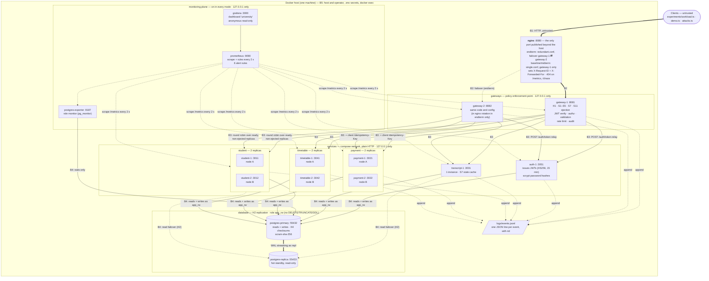
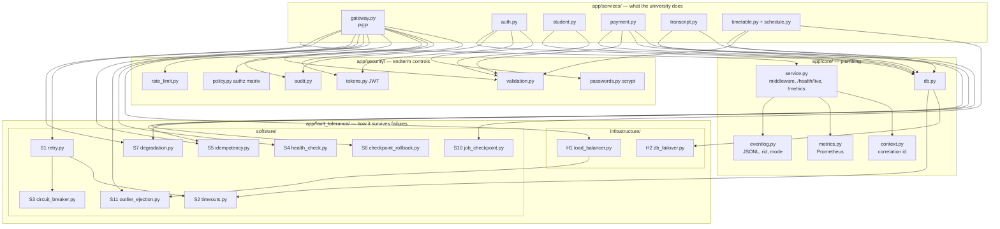
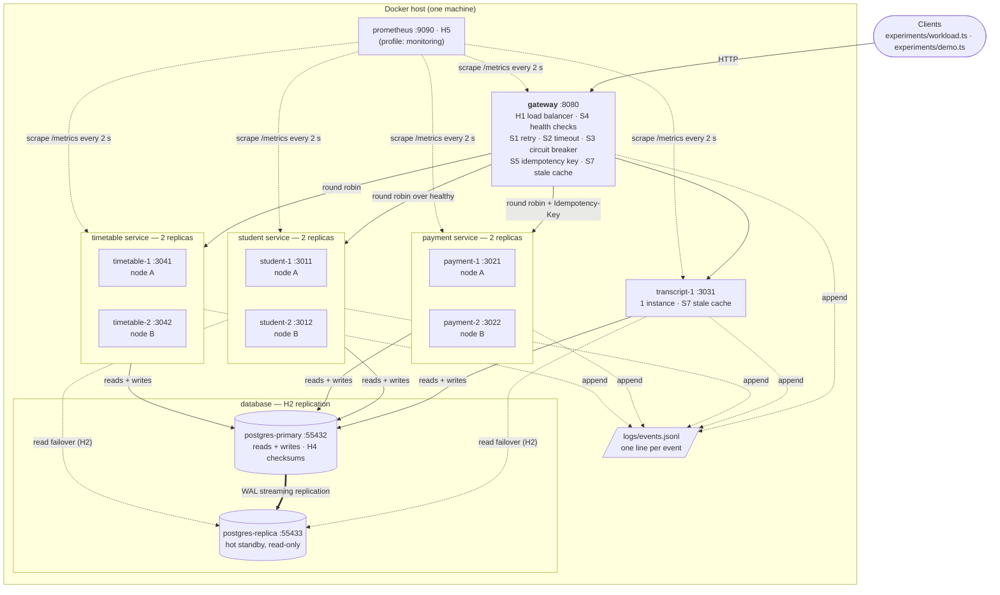

# System architecture

Sections 1 and 2 describe the **endterm** system, the version this repository deploys today. Section 3
keeps the midterm deployment diagram exactly as submitted (git tag `midterm-final`), so the two can be
compared. The same code and image run in three modes (section 7). The endterm report
([`endterm/REPORT.md`](endterm/REPORT.md)) explains the design. The threat model
([`endterm/THREAT-MODEL.md`](endterm/THREAT-MODEL.md)) takes its trust boundaries B1 to B5 from this page.

## 1. Deployment (endterm): redundant gateways, auth, monitoring plane, trust boundaries

* **Trust boundaries.** B1 is the only public boundary: clients reach nginx on `:8080` and nothing else.
  B2 (nginx to the gateways) hands the request to the policy enforcement point (PEP). B3 (gateways to
  services and `auth-1`) and B4 (services to PostgreSQL) stay inside the compose network. B5 is the host
  itself: the Docker daemon, the git-ignored `.env`, the shared `logs/` volume and every
  `127.0.0.1`-only port. Section 5 of the threat model lists the threats at each boundary.
* **No more single gateway.** In endterm nginx sends traffic to two gateways and moves to the other one
  on a connection error or a timeout (`proxy_connect_timeout 1s`, `proxy_read_timeout 5s`,
  `max_fails=1 fail_timeout=5s`). Because nginx may re-send a `POST` to the second gateway, endterm
  refuses a payment without a client `Idempotency-Key` (400). Baseline and midterm keep one gateway
  behind nginx (`single.conf`), which is the midterm topology.
* **Auth outside the request path.** `auth-1` is reached only for logins (`POST /auth/token`). The
  gateways check tokens locally with `JWT_SECRET`, so an `auth-1` outage blocks new logins but not
  requests that already carry a token.
* **The monitoring plane is outside the comparison.** Prometheus, Grafana and postgres-exporter run in
  every mode with `restart: unless-stopped`. All three modes are therefore measured the same way.
* **Still single:** nginx, `transcript-1`, `auth-1`, `postgres-primary` (no automatic promotion) and
  the host. See the endterm report §3.8.
* **Node A / node B** are logical, as in the midterm. All containers share one host.

### Trust boundaries and what guards each one

| Boundary | Crossed by | Guard | Mode |
|---|---|---|---|
| B1 client → nginx | every client request | only `:8080` is published, `X-Forwarded-For` is overwritten, `/metrics` and `/chaos*` return 404 (redundant.conf) | port binding in every mode, blocking in endterm |
| B2 nginx → gateways | proxied requests, failover re-sends | one `X-Request-ID` per request, reused on a re-send. Gateways listen on `127.0.0.1` only | every mode |
| B3 gateway → services, auth | upstream calls, login relay | JWT verification, authorization matrix, input validation, rate limits, audit. Only `content-type`, `idempotency-key` and `x-request-id` are forwarded, never the token. `/chaos*` needs `x-chaos-token` | endterm |
| B4 services → PostgreSQL | SQL, replication, exporter | `scram-sha-256` on every network line, least-privilege `app_rw`, `repl`, `monitor` roles, parameterised SQL | every mode |
| B5 host | operator, harness | generated secrets in git-ignored `.env`, loopback-only ports, superuser only over `docker exec` | every mode |

## 2. Code: business logic, fault tolerance and security are separate layers

The full list of mechanisms, with file links, is in
[`app/fault_tolerance/README.md`](../app/fault_tolerance/README.md). The security controls are listed in
[`endterm/THREAT-MODEL.md`](endterm/THREAT-MODEL.md) §6.

## 3. Deployment (midterm, as submitted at tag `midterm-final`)

Kept unchanged for comparison. In the current repository the "gateway :8080" box is `gateway-1` behind
nginx (`single.conf`) in baseline and midterm, which has the same topology. Prometheus is no longer
behind a profile.

## 4. Components

| Component | Instances | Data it owns | Fault-tolerance and security role | New in endterm |
|---|---|---|---|---|
| nginx | 1 | none | public entry point. Endterm: gateway failover, blocks `/metrics` and `/chaos*`, sets `X-Request-ID` and `X-Forwarded-For` | yes |
| gateway | **2** (`gateway-1`, `gateway-2`) | in-memory health map, outlier state, rate-limit buckets, last-good GET responses | H1, S1–S5, S7. Endterm: S11 outlier ejection, JWT verification, authorization, validation, rate limiting, audit, required payment `Idempotency-Key` | second instance, PEP |
| auth | 1 (`auth-1`) | `app_users` (scrypt hashes) | issues 15-minute HS256 JWTs. Login brute force is rate-limited at the gateway | yes |
| student | **2** | `students` | replicated, stateless. Reads fail over to the standby (H2) | strict validation (endterm) |
| payment | **2** | `payments` | S5 idempotency, S6 checkpoint before charge + rollback sweep, `payments_stale_pending` gauge | strict validation, stale-pending gauge |
| transcript | 1 | `grades` (read-only) + local cache | S7: stale data flagged `degraded` (HTTP 203) when the database is gone | — |
| timetable | **2** | `courses`, `rooms`, `timetable_jobs` | S10: durable checkpoints. A live replica adopts a dead one's job | strict validation (endterm) |
| postgres-primary | 1 | everything | the only writable copy. H4 page checksums. Roles `app_rw`, `repl`, `monitor` | passwords, least privilege |
| postgres-replica | 1 | streaming copy | H2 hot standby for reads | replicates as `repl` |
| prometheus | 1, always on | time series | scrapes every 2 s, evaluates 6 alert rules every 2 s | always on, alert rules |
| grafana | 1, always on | dashboard definition | dashboard `university`: request rate, error ratio, latency, upstream outcomes, health, ejection, breakers, auth denials, stale payments, DB, alerts | yes |
| postgres-exporter | 1, always on | none | `pg_up` (`DatabaseDown`) and replication statistics | yes |

Every application container has a Docker healthcheck on `GET /health/live` (interval 2 s, 3 retries,
start period 5 s). Liveness never touches the database, so a database outage does not mark healthy
processes unhealthy. Readiness (`GET /health/ready`, alias `/health`) is what the gateway's S4 health
check polls.

## 5. Request flow (endterm)

1. A client calls `POST /auth/token` with a username and password. nginx relays it to a gateway, the
   gateway relays it to `auth-1`, and `auth-1` returns a JWT valid for 15 minutes.
2. The client calls `GET|POST /api/{students|payments|transcripts|timetables}/...` on nginx `:8080`.
   nginx assigns an `X-Request-ID` if the client sent none, overwrites `X-Forwarded-For`, and picks a
   gateway. On a connection error or a timeout it re-sends to the other gateway with the same request ID.
3. The gateway (PEP) accepts the request ID only if it matches `[A-Za-z0-9._-]{8,64}`, and otherwise
   replaces it with a fresh UUID. Then it applies its edge limits: body ≤ 16 384 bytes (413), JSON
   object body on POST (400), safe path segments (400). Then, in this order, it verifies the token
   (401), applies the per-principal rate limit (429 with `Retry-After`) and applies the authorization
   matrix (403). It writes an audit event for every deny, every payment allow and every admin action.
4. **H1 + S4 + S11:** the gateway picks the next replica that is ready and not ejected. Three failed
   attempts in a row on one replica eject it for 10 s, but never more than half of a pool.
5. **S5:** a `POST /api/payments` must carry the client's `Idempotency-Key` (400 otherwise). The key
   and the request ID are forwarded. The token is not.
6. **S2 + S1 + S3:** the call runs under an 800 ms timeout, is retried on the next replica with
   exponential backoff and full jitter (up to 3 attempts), and five consecutive failures open the
   pool's circuit breaker for 5 s.
7. **S7:** if every attempt fails on a GET, the gateway answers from its last-good copy (HTTP 203,
   `degraded: true`) when that copy is less than 60 s old.
8. Every hop logs JSON lines with the same `rid` to `logs/events.jsonl` and updates its Prometheus
   metrics (`http_requests_total`, `http_request_duration_seconds`, `upstream_attempts_total`, ...).
   Prometheus scrapes them every 2 s and evaluates the alert rules.

## 6. What changed since the midterm

| Midterm | Endterm | Why |
|---|---|---|
| one gateway on `:8080`, the largest single point of failure (midterm REPORT §4.4) | nginx on `:8080` in front of `gateway-1` and `gateway-2` | the gateway is no longer a SPOF (E7) |
| per-pool circuit breaker only, so a slow replica stayed in rotation (midterm REPORT §11) | + per-instance outlier ejection (S11) | a slow replica is taken out of the ring (E3) |
| one `/health` | `/health/live` (Docker healthcheck) and `/health/ready` (gateway S4) | a DB outage must not get healthy processes restarted |
| JSONL events, `ft_events_total` | + correlation ID on every hop, request/latency/upstream/auth metrics, Grafana, 6 alert rules, postgres-exporter | detection and diagnosis (E8) |
| no authentication, `trust` database, open `/chaos` | auth service, JWTs, authorization, audit, validation, rate limits, passwords, least-privilege roles, chaos token | security and intrusion tolerance (E9, E10) |

## 7. Three modes, one image

All three modes run the **same image**. `experiments/env.ts` writes the switches into `.env`:

| Mode | `FT_ENABLED` | `ENDTERM_ENABLED` | `RESTART_POLICY` | `NGINX_PROFILE` |
|---|---|---|---|---|
| baseline | 0 | 0 | `no` | `single` |
| midterm | 1 | 0 | `unless-stopped` | `single` |
| endterm | 1 | 1 | `unless-stopped` | `redundant` |

`FT_ENABLED=0` turns off every midterm software mechanism (one attempt, no timeout, no breaker, blind
round robin, no standby reads, idempotency key ignored, no recovery sweeps, no timetable checkpoints).
`ENDTERM_ENABLED=1` turns on the new behaviour: outlier ejection, the second gateway in rotation,
authentication and authorization, strict validation, rate limiting, the required payment
`Idempotency-Key` and the chaos token check. Correlation IDs, metrics, structured logs, Prometheus,
Grafana, the alert rules, Docker healthchecks, database passwords and least-privilege roles are on in
**every** mode. They are how the modes are measured and how credentials are handled, not behaviour
under test. The replicas, the standby, the second gateway container and the checksums exist in every
mode. Hardware redundancy without the software that uses it is exactly what the baseline measures.
