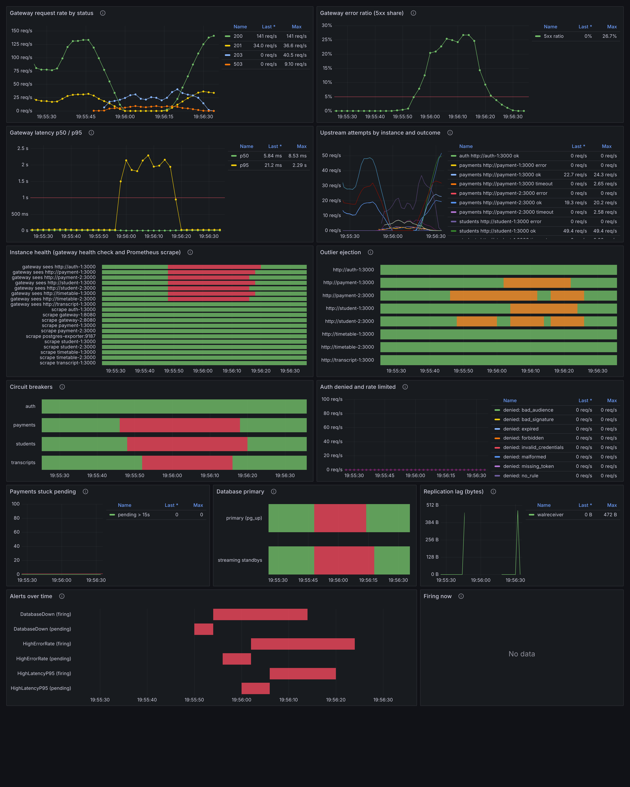

# Observability: how an incident is detected and diagnosed

This document follows one real incident from the endterm campaign from start to finish: run
`db-failure__endterm__r1` (E2, the PostgreSQL primary is stopped for 25 s while the normal workload
runs). Every timestamp, count and duration below is copied or computed from these files, which the
campaign wrote. Nothing in them was edited.

| Source | What it holds |
|---|---|
| `logs/endterm/db-failure__endterm__r1/events.jsonl.gz` | 32 750 structured log lines from gateway-1/2 and every service instance (one JSON object per line, each with `rid`) |
| `logs/endterm/db-failure__endterm__r1/workload.jsonl.gz` | 7 818 client-side records, one per request the harness sent (`ts` = send time, `ms` = client latency, `rid` = the `X-Request-ID` it sent) |
| `logs/endterm/db-failure__endterm__r1/alerts.json` | Prometheus `/api/v1/alerts` polled once a second (71 polls, 0 poll errors), folded into pending/firing/resolved times per alert |
| `reports/endterm/runs/db-failure__endterm__r1/metrics.json` | the run summary: `t0`, `injectTs`, `repairTs`, `t1`, request counts, detection, alerts, integrity, acceptance |
| `reports/endterm/figures/db-failure__endterm__r1{,-full}.png` | the Grafana dashboard `university` over the run window (`experiments/snapshot.ts`) |

Times are UTC on 2026-11-09, the zone Grafana shows. "+N ms" is relative to the injection
(`injectTs` = 1794254145255 = 19:55:45.255).

## 1. The run in one table

| Moment | Epoch ms (source) | UTC | Relative |
|---|---|---|---|
| Observation starts | `t0` 1794254125255 (metrics.json) | 19:55:25.255 | −20 000 ms |
| `docker compose stop postgres-primary` issued | `injectTs` 1794254145255 | 19:55:45.255 | 0 |
| Primary restarted | `repairTs` 1794254170256 | 19:56:10.256 | +25 001 ms |
| Observation ends | `t1` 1794254195772 | 19:56:35.772 | +50 517 ms |

Outcome (metrics.json): 7 818 requests, 7 571 successful, 247 failed (error rate 3.16 %), 1 017
degraded (served as HTTP 203). Read availability was 0.998 (`readRequestBased`), and the integrity
check found 0 duplicate charges and 0 lost records (`consistency.duplicateCharges` and `lostRecords`).
All 4 acceptance criteria passed. Alert correctness is `false`, because one alert fired that the
scenario does not list (`unexpected: ["HighLatencyP95"]`). Section 5 explains why it fired.

## 2. How a request ID ties the hops together

The harness sends every request with its own `X-Request-ID`: the run ID plus a sequence number, such
as `db-failure-endterm-r1-1794254125250-3321`. The ID passes through each hop as follows:

1. **nginx** (`config/nginx/redundant.conf`) passes the client's `X-Request-ID` to the gateway it
   picks. It only creates an ID (`$request_id`) when the client sent none. nginx keeps no access log
   (`access_log off`), because the gateways already log every request with its rid and an nginx copy
   would duplicate those lines. So nginx contributes **no log line** to this walkthrough. You can tell
   which gateway nginx chose from the `svc` field of the gateway lines. nginx's error log (`docker logs
   fault-tolerance-nginx-1`) has no entry between 19:55:25 and 19:56:35: the gateways stayed up and
   only the database failed.
2. **gateway-1 / gateway-2** check the ID (a hostile value is replaced by a fresh UUID; see Task 2,
   `test_hostile_request_id_replaced`). They log `audit`, `attempt`, `breaker`, `ejection`,
   `upstream`, `degraded` and `request` events under that rid. Every retry to another replica sends
   the **same** `X-Request-ID`.
3. **student / transcript / payment instances** log their own `request` and `degraded` events under
   the rid they received.
4. Work that no request triggers uses a different rid. Health probes log as `health-<uuid>`.
   Background loops (timetable recovery, payment reconciliation) log `rid: null`.

So filtering on one rid across both files gives the full path of a request: the client, the gateway
nginx chose, and every replica the gateway tried.

## 3. One failed payment, hop by hop (rid `…-3321`)

This POST was sent 264 ms after the injection. The command below reproduces the excerpt. It prints
the client record first, then the 11 server-side lines for this rid in file order:

```sh
R='"rid":"db-failure-endterm-r1-1794254125250-3321"'
zcat logs/endterm/db-failure__endterm__r1/workload.jsonl.gz | grep "$R"
zcat logs/endterm/db-failure__endterm__r1/events.jsonl.gz  | grep "$R"
```

```json
{"ts":1794254145519,"op":"payments","status":503,"ok":false,"degraded":false,"ms":935,"intent":"db-failure-endterm-r1-1794254125250-631","retry":false,"rid":"db-failure-endterm-r1-1794254125250-3321","rateLimited":false}
{"ts":1794254145521,"svc":"gateway-1","ft":1,"mode":"endterm","rid":"db-failure-endterm-r1-1794254125250-3321","level":"info","kind":"audit","action":"POST /api/payments","outcome":"allow","reason":"ok","sub":"bursar","role":"staff","student_id":null,"student":"s74","idempotency_key":"db-failure-endterm-r1-1794254125250-631"}
{"ts":1794254145534,"svc":"payment-1","ft":1,"mode":"endterm","rid":"db-failure-endterm-r1-1794254125250-3321","level":"error","kind":"request","target":"POST /","ok":false,"status":503,"ms":3}
{"ts":1794254145537,"svc":"gateway-1","ft":1,"mode":"endterm","rid":"db-failure-endterm-r1-1794254125250-3321","level":"error","kind":"attempt","target":"payments","ok":false,"attempts":1,"breaker":"closed","err":"upstream 503"}
{"ts":1794254145579,"svc":"payment-2","ft":1,"mode":"endterm","rid":"db-failure-endterm-r1-1794254125250-3321","level":"error","kind":"request","target":"POST /","ok":false,"status":503,"ms":1}
{"ts":1794254145580,"svc":"gateway-1","ft":1,"mode":"endterm","rid":"db-failure-endterm-r1-1794254125250-3321","level":"error","kind":"ejection","target":"http://payment-2:3000","state":"ejected","ok":false,"failures":3,"eject_ms":10000}
{"ts":1794254145580,"svc":"gateway-1","ft":1,"mode":"endterm","rid":"db-failure-endterm-r1-1794254125250-3321","level":"info","kind":"breaker","target":"payments","state":"open"}
{"ts":1794254145580,"svc":"gateway-1","ft":1,"mode":"endterm","rid":"db-failure-endterm-r1-1794254125250-3321","level":"error","kind":"attempt","target":"payments","ok":false,"attempts":2,"breaker":"open","err":"upstream 503"}
{"ts":1794254146448,"svc":"gateway-1","ft":1,"mode":"endterm","rid":"db-failure-endterm-r1-1794254125250-3321","level":"error","kind":"attempt","target":"payments","ok":false,"attempts":3,"breaker":"open","err":"TimeoutError"}
{"ts":1794254146448,"svc":"gateway-1","ft":1,"mode":"endterm","rid":"db-failure-endterm-r1-1794254125250-3321","level":"error","kind":"upstream","target":"payments","ok":false,"ms":923,"attempts":3,"breaker":"open","err":""}
{"ts":1794254146448,"svc":"gateway-1","ft":1,"mode":"endterm","rid":"db-failure-endterm-r1-1794254125250-3321","level":"error","kind":"request","target":"POST /api/payments","ok":false,"status":503,"ms":927}
{"ts":1794254146649,"svc":"payment-1","ft":1,"mode":"endterm","rid":"db-failure-endterm-r1-1794254125250-3321","level":"error","kind":"request","target":"POST /","ok":false,"status":503,"ms":1001}
```

Read in order, the lines say:

- **Client → nginx → gateway-1.** The harness sent the POST at 19:55:45.519. nginx passed it to
  gateway-1, which logged the authorization decision 2 ms later (`audit`, staff role `bursar`,
  `allow`). The decision carries the client's `Idempotency-Key`. The password and the bearer token
  are not logged.
- **Attempt 1 → payment-1.** payment-1 answered 503 in 3 ms, because it has no database connection.
  The gateway records `attempt` 1 as failed (`upstream 503`).
- **Attempt 2 → payment-2**, with the same rid and the same idempotency key. This also returned 503.
  gateway-1 had now counted 3 failures for payment-2, so it **ejected** payment-2 for
  10 000 ms (`ejection`, `failures: 3`). In the same millisecond the `payments` **circuit breaker
  opened**.
- **Attempt 3 → payment-1 again.** The gateway gave up after about 0.87 s (`TimeoutError`). payment-1
  only answered 201 ms later (`ms: 1001`), because it had waited 1 s for a connection from its pool.
  The payment service's own log line shows the same 1 s wait:
  `"err":"couldn't get a connection after 1.00 sec"` (payment-1 at 1794254155067, `rid: null`).
- **gateway-1 → client: 503 after 927 ms**, and the client measured 935 ms. A POST is never answered
  from cache, so the gateway fails fast and does not degrade. The intent was not acknowledged and so
  does not count toward the "lost" check. The run's `unacknowledgedIntents` is 194, while
  `lostRecords` and `duplicateCharges` are both 0.

## 4. One degraded read, hop by hop (rid `…-3630`)

Reads behave differently. In this run, the replica failover worked but was too slow for the gateway's
per-attempt budget:

```json
{"ts":1794254153312,"op":"students","status":203,"ok":true,"degraded":true,"ms":2438,"retry":false,"rid":"db-failure-endterm-r1-1794254125250-3630","rateLimited":false}
{"ts":1794254154114,"svc":"gateway-2","ft":1,"mode":"endterm","rid":"db-failure-endterm-r1-1794254125250-3630","level":"error","kind":"attempt","target":"students","ok":false,"attempts":1,"breaker":"open","err":"TimeoutError"}
{"ts":1794254154316,"svc":"student-1","ft":1,"mode":"endterm","rid":"db-failure-endterm-r1-1794254125250-3630","level":"info","kind":"degraded","target":"db","reason":"read_from_replica"}
{"ts":1794254154316,"svc":"student-1","ft":1,"mode":"endterm","rid":"db-failure-endterm-r1-1794254125250-3630","level":"info","kind":"request","target":"GET /s94","ok":true,"status":200,"ms":1001}
{"ts":1794254154918,"svc":"gateway-2","ft":1,"mode":"endterm","rid":"db-failure-endterm-r1-1794254125250-3630","level":"error","kind":"attempt","target":"students","ok":false,"attempts":2,"breaker":"open","err":"TimeoutError"}
{"ts":1794254155120,"svc":"student-2","ft":1,"mode":"endterm","rid":"db-failure-endterm-r1-1794254125250-3630","level":"info","kind":"degraded","target":"db","reason":"read_from_replica"}
{"ts":1794254155120,"svc":"student-2","ft":1,"mode":"endterm","rid":"db-failure-endterm-r1-1794254125250-3630","level":"info","kind":"request","target":"GET /s94","ok":true,"status":200,"ms":1001}
{"ts":1794254155749,"svc":"gateway-2","ft":1,"mode":"endterm","rid":"db-failure-endterm-r1-1794254125250-3630","level":"error","kind":"attempt","target":"students","ok":false,"attempts":3,"breaker":"open","err":"TimeoutError"}
{"ts":1794254155749,"svc":"gateway-2","ft":1,"mode":"endterm","rid":"db-failure-endterm-r1-1794254125250-3630","level":"error","kind":"upstream","target":"students","ok":false,"ms":2435,"attempts":3,"breaker":"open","err":""}
{"ts":1794254155749,"svc":"gateway-2","ft":1,"mode":"endterm","rid":"db-failure-endterm-r1-1794254125250-3630","level":"info","kind":"degraded","target":"students","reason":"stale_cache","ageMs":13988}
{"ts":1794254155749,"svc":"gateway-2","ft":1,"mode":"endterm","rid":"db-failure-endterm-r1-1794254125250-3630","level":"info","kind":"request","target":"GET /api/students/s94","ok":true,"status":203,"ms":2436}
{"ts":1794254155952,"svc":"student-1","ft":1,"mode":"endterm","rid":"db-failure-endterm-r1-1794254125250-3630","level":"info","kind":"degraded","target":"db","reason":"read_from_replica"}
{"ts":1794254155953,"svc":"student-1","ft":1,"mode":"endterm","rid":"db-failure-endterm-r1-1794254125250-3630","level":"info","kind":"request","target":"GET /s94","ok":true,"status":200,"ms":1001}
```

Both student instances served `GET /s94` correctly from the hot standby (`read_from_replica`,
`status 200`). Each did so only after `ms: 1001`, the same 1 s wait for a connection to the dead
primary. The gateway's attempts gave up 802 ms, 804 ms and 831 ms apart (send at …153312; attempt
timeouts at …154114, …154918, …155749). Three replica answers that would have been correct therefore
arrived after the gateway had stopped waiting. The gateway then served its last good copy of
`students/s94` (`stale_cache`, `ageMs` 13 988) and logged `status: 203` after 2 436 ms. The client
measured the same 203 at 2 438 ms.

The same pattern appears across the whole fault window (+0 to +25 001 ms):

| What | Count in the fault window | How it was counted |
|---|---|---|
| student `request` lines taking ≥ 1 000 ms / < 1 000 ms | 81 / 29 | `events.jsonl.gz`, `svc` student-*, `kind` request |
| transcript `request` lines taking ≥ 1 000 ms / < 1 000 ms | 51 / 14 | same, transcript-1 |
| gateway attempts failed with `TimeoutError` (students / transcripts / payments) | 81 / 51 / 111 | `kind` attempt, `ok` false |
| gateway answers from `stale_cache` | 614 | `kind` degraded, `svc` gateway-* |
| client responses: students 203 / transcripts 203 / payments 503 | 459 / 156 / 183 | `workload.jsonl.gz`, by `op` and `status` |

The first replica read was fast. `…-3314`, sent 225 ms after the stop, logged
`read_from_replica`, `ms: 9` on student-2, and the client got a plain 200 in 20 ms. The 1 s wait
appears once the pool's connections to the primary have closed and every read first waits
`couldn't get a connection after 1.00 sec`.

**Diagnosis:** the standby is healthy. The slowness comes from waiting for the primary before falling
back to the standby. The fix is either to try the replica sooner or to give the gateway's
per-attempt budget room for the fallback. This is the root cause of the `HighLatencyP95` alert
(section 5).

## 5. Detection: from the first symptom to the alert

Every signal, in the order it appeared (events.jsonl.gz and workload.jsonl.gz for the logs,
alerts.json for the alerts):

| Relative | Signal | Where it is visible |
|---|---|---|
| +232 ms | first client request that will fail is sent (`…-3315`, payments 503 after 908 ms). The harness reports this as `detectionMs: 232` (`detectionSource: "client-visible failure"`) | workload |
| +237 ms | first `read_from_replica` (student-2, `…-3314`) | service log |
| +252 ms | first service error (payment-2 `request` 503, `…-3315`) | service log |
| +255 ms | first failed gateway `attempt` (gateway-1, `…-3315`) | gateway log, `upstream_attempts_total{outcome="error"}` |
| +325 ms | first ejection (payment-2 on gateway-1) and payments breaker open (`…-3321`) | gateway log, `instance_ejected`, `circuit_breaker_open` |
| +461 ms | first failed health probe (gateway-2 → timetable-2, `True->False`). Within +1 436 ms both gateways had marked auth-1, payment-1/2, student-1/2 and timetable-1/2 down (14 transitions). transcript-1 stays ready, because its readiness check accepts the cache in FT mode | gateway log, `instance_up` |
| +808 ms | timetable-2: `terminating connection due to administrator command` (the primary shutting down) | service log (`rid: null`) |
| +1 933 ms / +1 966 ms | students breaker opens on gateway-2 / gateway-1 | gateway log |
| +3 593 ms | **DatabaseDown pending** (`pg_up == 0`; Prometheus `activeAt`) | alerts.json |
| **+8 001 ms** | **DatabaseDown firing** (rule `for: 4s`) | alerts.json, metrics.json `alerts[0].detectionMs` |
| +9 593 ms | HighErrorRate pending | alerts.json |
| +13 593 ms | HighLatencyP95 pending | alerts.json |
| +16 005 ms | **HighErrorRate firing** | alerts.json |
| +20 005 ms | **HighLatencyP95 firing** | alerts.json |
| +25 001 ms | primary restarted (`repairTs`) | metrics.json |
| +28 004 ms | DatabaseDown resolved (3 003 ms after repair) | alerts.json |
| +28 907 ms → +31 947 ms | all 14 health transitions back to `False->True` | gateway log |
| +31 944 ms | last failed client request sent (`…-4662`, students 503 in 9 ms) | workload |
| +33 212 ms | last breaker closes (students on gateway-1) | gateway log |
| +34 005 ms | HighLatencyP95 resolved | alerts.json |
| +38 006 ms | HighErrorRate resolved | alerts.json |

**Is each alert correct?**

| Alert | Expected by the scenario | Fired | Detection (firing − inject) | Verdict |
|---|---|---|---|---|
| DatabaseDown | must fire | yes | 8 001 ms (criterion ≤ 10 000 ms: pass) | correct: names the root cause |
| HighErrorRate | may fire | yes | 16 005 ms | correct symptom: the gateway 5xx share peaked at 26.7 % (figure, "Gateway error ratio" legend max), almost all of it payment POSTs failing fast |
| HighLatencyP95 | not listed | yes | 20 005 ms | a true symptom but not anticipated: the gateway p95 reached 2.29 s (figure, "Gateway latency" legend max) because of the 1 s primary wait described in section 4. The run is scored `correct: false` for this. The alert is real; the scenario's expectation was too narrow |

There are two detection paths, and they work on different time scales. **In-band**, the gateway
noticed the fault in about 0.25 s and reacted by itself: retry, ejection, breaker, stale cache and
replica reads. **Operator-facing**, Prometheus scrapes `pg_up` every 2 s, evaluates rules every 2 s
and requires 4 s (`for: 4s`), so the page arrives at +8 s. That page names the component that failed.
The two symptom alerts fire later, because their 15 s rate windows must first fill with bad samples.

## 6. Diagnosis on the dashboard



`figures/db-failure__endterm__r1-full.png` shows the dashboard over the run window (19:55:25 to
19:56:35). Read top to bottom, it answers the on-call questions in order:

1. **Is it user-visible?** *Gateway request rate by status*: from about 19:55:50, 200s collapse,
   and 203 (degraded) and 503 rise. The legend maxima are 40.5 req/s of 203 and 9.10 req/s of 503.
   *Gateway error ratio* crosses the 5 % line (max 26.7 %). *Gateway latency p95* crosses the 1 s
   line (max 2.29 s), while p50 stays below 9 ms (max 8.53 ms). This means most requests are still
   fast; a minority are slow.
2. **Is one instance bad, or all of them?** *Instance health* shows every DB-backed instance red on
   **both** replicas at the same moment (auth-1, payment-1/2, student-1/2, timetable-1/2). The
   Prometheus `scrape` rows stay green: the processes are alive and only their readiness failed.
   *Outlier ejection* shows payment-1/2 and student-1/2 ejected in turn, and *Circuit breakers* shows
   payments, students and transcripts open. When every replica of several pools fails at once while
   the containers are still scraped, a shared dependency is the cause, not an instance.
3. **Which dependency?** *Database primary*: `pg_up` and "streaming standbys" both red for the same
   interval. *Alerts over time*: DatabaseDown pending, then firing first; HighErrorRate and
   HighLatencyP95 follow.
4. **Is data at risk?** *Payments stuck pending* stays at 0 throughout (max 0). This matches the
   integrity check (0 lost, 0 duplicate, 0 orphaned pending in metrics.json).
5. **Pick a request and read its story.** Take any rid from the failing interval in the workload log
   and grep it in `events.jsonl.gz` (sections 3 and 4). The rid shows which gateway, which replicas,
   which attempts timed out, and that the student services *did* answer from the replica, but after
   1 001 ms. That last fact cannot be seen from metrics alone.

The 1600×1000 figure specified by the plan (`figures/db-failure__endterm__r1.png`) shows the first
three rows: request rate, error ratio, latency, upstream attempts, instance health and ejection. The
`-full` variant shows all 13 panels.

## 7. The other snapshots

`node --experimental-strip-types experiments/snapshot.ts <tag> … --full` produced two PNGs per run.
`<tag>.png` is the 1600×1000 viewport from the plan. `<tag>-full.png` is 1600×2000, which fits every
row. Each image was opened after capture to check that its panels show data. None shows a loading
spinner or a login page, because Grafana allows anonymous Viewer access.

| Run | Figure | What it shows | Alerts (metrics.json, detection) |
|---|---|---|---|
| E2 db-failure r1 | `figures/db-failure__endterm__r1{,-full}.png` | section 6 | DatabaseDown 8 001 ms, HighErrorRate 16 005 ms, HighLatencyP95 20 005 ms (unexpected) |
| E4 node-failure r1 | `figures/node-failure__endterm__r1{,-full}.png` | payment-1 and student-1 red in health and scrape; both ejected briefly; no 5xx (error ratio flat at 0); p95 stays near 22 ms | InstanceDown 5 003 ms, correct |
| E8 error-spike r1 | `figures/error-spike__endterm__r1{,-full}.png` | 503 up to 44.7 req/s and 203 up to 114 req/s; error ratio max 23.4 %; payments and students breakers open; health stays green (the instances answer 5xx but are ready) | HighErrorRate 10 009 ms, correct |
| E9 unauthorized-access r1 | `figures/unauthorized-access__endterm__r1{,-full}.png` | 401 (max 1.59 req/s) and 403 (max 1.16 req/s) in the status panel; *Auth denied* by reason (forbidden, bad_signature, expired, malformed, missing_token); no 5xx | AuthFailureSpike 8 008 ms, correct |
| E10 abuse r1 | `figures/abuse__endterm__r1{,-full}.png` | 422 (max 12.7 req/s) and 429 (max 5.05 req/s) in the status panel; p95 rises to 45.1 ms during the burst; *Auth denied and rate limited* shows the burst | AuthFailureSpike 10 005 ms, correct |

### Panels that are empty, and why

- **Firing now** reads "No data" in all five snapshots. It is an *instant* query (`ALERTS{alertstate="firing"}`)
  evaluated at the end of the selected range (`t1`). Every alert in these runs had resolved before
  `t1`; for example, the last one in E2 resolved at +38 006 ms and `t1` is +50 517 ms. The
  *Alerts over time* panel next to it shows the alert history.
- **Payments stuck pending** is flat at 0 in all five runs. No payment stayed pending past 15 s.
  That is the correct value, not a missing series.
- **Gateway error ratio** shows a 0–10 000 % y-axis in E4, E9 and E10. The series is constant 0 (no
  5xx), and Grafana's auto-scaling with `percentunit` and only `min: 0` set draws that range. The
  data (0 %) is correct; only the axis is cosmetic.
- **Auth denied and rate limited** is flat at 0 in E2, E4 and E8, because no request was denied.
- **Legend tables cut off.** The *Upstream attempts* legend (and in E10 the *Auth denied and rate
  limited* legend) has more rows than fit in the panel, so the last rows (for example `students
  http://student-2:3000 …` and the `rate_limited` series) are clipped. The lines are still drawn in
  the plot.

## 8. Limitations

- nginx does not log the rid, so it appears in this walkthrough only as the hop that kept the rid and
  chose a gateway. Turning on an nginx access log with `$rid` would add that line, at the cost of
  one extra log line per request.
- Workload timestamps are send times. The harness's `detectionMs` (232 ms) therefore dates the first
  failing request by when it was sent, not by when its 503 arrived (+1 140 ms for `…-3315`).
- alerts.json polls once a second, so `firstFiringTs` and `resolvedTs` have 1 s resolution.
  `firstPendingTs` is Prometheus' own `activeAt`.
- This is one repetition. The aggregate over three repetitions (DatabaseDown 8.34 s ± 0.56 s,
  HighErrorRate 17.01 s ± 1.01 s, HighLatencyP95 19.67 s ± 0.59 s; correct 0/3 because HighLatencyP95
  fired every time) is in `RESULTS.md`.
