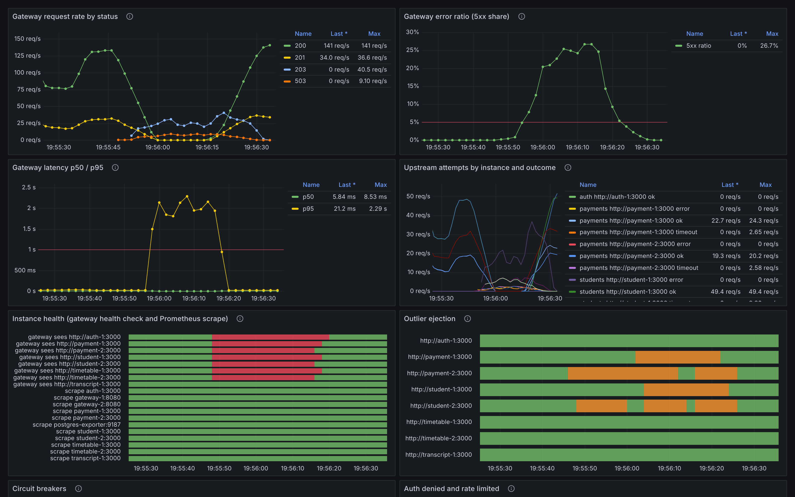
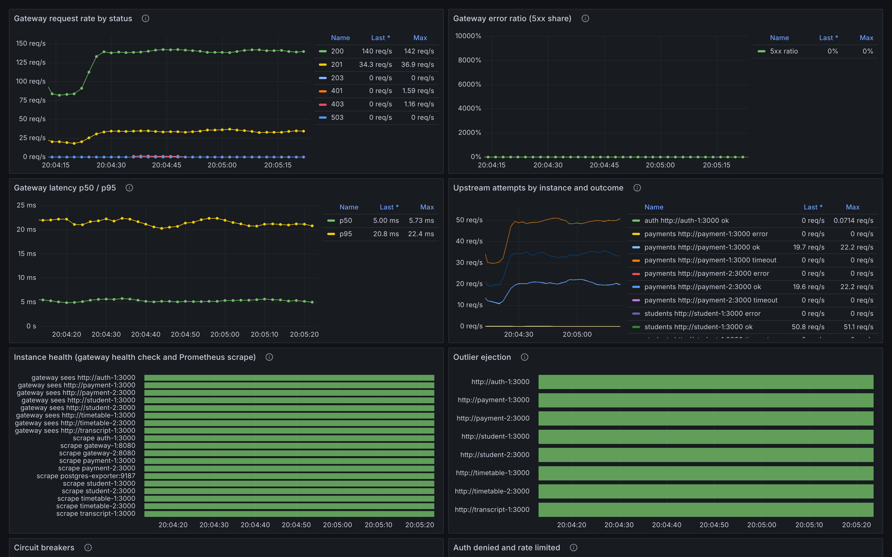

# Resilient University Information System — Endterm Technical Report

Course: Fault Tolerance and Dependable Computing — Endterm project (continuation of the midterm)

Team: Aibyn Talgatov, CSE-2505M (`a169n` / `Aibyn`) and Gani Uapov, CSE-2502M (`9an1`). How the work
was done, and by whom, is in §11.6.

**Status of this document.** Sections 1 to 7 and the appendix describe the design, the implementation
and the methodology; they were written before the results and do not depend on them. Sections 8, 9
and 10 report and discuss the three-mode campaign (90 runs). Every measured endterm number traces to
[`RESULTS.md`](RESULTS.md), [`results.csv`](results.csv), a run's `metrics.json` or, where marked,
the raw logs under `logs/endterm/`. Midterm numbers are cited from the committed midterm report
(`reports/REPORT.md`) or comparison (`reports/COMPARISON.md`). The dependency-audit counts of §5.4
come from the committed `pip-audit` output files, and the post-upgrade check of §5.4 from the
`metrics.json` files under `reports/endterm/post-upgrade/`.

---

## 1. Introduction and relationship to the midterm project

The midterm project built a small university platform (students, payments, transcripts, timetables)
twice from one image: a **baseline** with no fault-tolerance logic and a **fault-tolerant** version
(`FT_ENABLED=1`). It injected six faults into each and measured the difference
([`reports/REPORT.md`](../REPORT.md), [`reports/COMPARISON.md`](../COMPARISON.md)). The midterm
submission is frozen at git tag `midterm-final` (commit `51100cf`, which is also `origin/main`). The tag
could not be pushed from the environment in which this work was done, so a fresh clone may not have it:
there, use `51100cf` or `origin/main` wherever this report names `midterm-final`.

The endterm extends that system. It does not replace it (spec §4). The same four business services,
the same payment workflow (idempotency key, checkpoint before the charge, rollback sweep), the same
PostgreSQL primary with a hot standby and the same TypeScript experiment harness are reused. On top of
them the endterm adds the four topics of the assignment:

- **cloud and microservice resilience:** a redundant gateway pair behind nginx, per-instance outlier
  ejection, a liveness/readiness split and container healthchecks;
- **fault detection and observability:** correlation IDs on every hop, request, latency, upstream and
  security metrics, an always-on Prometheus/Grafana/postgres-exporter monitoring plane and six alert
  rules with unit tests;
- **security and intrusion tolerance:** an auth service issuing short-lived JWTs, an authorization
  policy enforced at the gateway, audit logging, strict input validation, rate limiting, generated
  secrets, least-privilege database roles and a locked-down chaos endpoint;
- **verification and fault injection:** unit, harness, configuration and integration tests, a CI
  pipeline, four new scenarios (ten in total, E1 to E10), explicit acceptance criteria, alert and
  resource capture, key-level integrity checks, three repetitions per mode and three modes.

### 1.1 Three deployable modes

The midterm's two modes become three, all from one image and one `docker-compose.yml`
(`experiments/env.ts`, `npm run up:<mode>`):

| Mode | `FT_ENABLED` | `ENDTERM_ENABLED` | Restart policy | nginx config | Role in the comparison |
|---|---|---|---|---|---|
| baseline | 0 | 0 | `no` | `single.conf` (gateway-1 only) | the midterm baseline: redundancy exists, no software uses it |
| midterm | 1 | 0 | `unless-stopped` | `single.conf` | the midterm fault-tolerant system |
| endterm | 1 | 1 | `unless-stopped` | `redundant.conf` (gateway-1 ⇄ gateway-2) | this project |

`ENDTERM_ENABLED=1` gates every new **behaviour**: outlier ejection, the second gateway in rotation,
authentication and authorization, strict validation, rate limiting, the required payment
`Idempotency-Key` and the chaos-token check. Correlation IDs, metrics, structured logs, Prometheus,
Grafana, the alert rules, Docker healthchecks, database passwords and least-privilege roles are on in
**every** mode. They are how the three modes are measured, and how credentials are handled; they are
not behaviour under test. This keeps the comparison fair: all three modes are observed by the same
instruments, and only the mechanisms under test differ.

### 1.2 Major changes since `midterm-final`

Taken from `git log midterm-final..HEAD` (in a fresh clone without the tag: `git log 51100cf..HEAD`).
Every change is described in more detail in the section named in the last column.

| Commit(s) | Change | Section |
|---|---|---|
| `ffc453b` | endterm implementation plan and the assignment specs added to `docs/` | — |
| `d66a0eb` | third deployable mode (`ENDTERM_ENABLED`), mode → `.env` builder, generated secrets in a git-ignored `.env` | 1.1, 5.2 |
| `f833e97` | unit tests for the midterm mechanisms (the midterm had none) | 6 |
| `b1cb300` | request/correlation IDs across nginx, gateway and services; hostile IDs replaced | 4.2 |
| `05734f7`, `be348bb` | Prometheus metrics: requests, latency, upstream attempts, health, breakers, ejection, auth denials, stale payments | 4.3 |
| `81b8070` | Prometheus, Grafana and postgres-exporter always on; six alert rules with promtool tests; Grafana dashboard | 4.4, 4.5 |
| `7d41652` | `/health/live` vs `/health/ready`; Docker healthchecks on every app container | 3.3 |
| `846f63d` | per-instance outlier ejection (S11) | 3.4 |
| `fdd68dd` | nginx in front of `gateway-1` and `gateway-2` (H6); payments require a client `Idempotency-Key` in endterm | 3.2, 3.6 |
| `6e7510b` | STRIDE threat model ([`THREAT-MODEL.md`](THREAT-MODEL.md)) | 2.4 |
| `b9023fd`, `ce08f9e` | `auth` service: scrypt password hashes, HS256 JWTs (15 min) | 5.1 |
| `e8e47d1`, `2fbb33e` | gateway authorization matrix (fail closed) and audit log | 5.1, 5.3 |
| `2a7c486` | strict input validation and request limits | 5.1 |
| `91663ec` | per-principal and per-IP rate limiting | 5.1 |
| `d6745f1` | secrets out of the repository, `scram-sha-256`, least-privilege roles `app_rw` / `repl` / `monitor`, loopback-only ports, chaos-endpoint token | 5.1, 5.2 |
| `9f6541c`, `981592c` | auth-aware workload, alert and resource capture, key-level integrity, acceptance criteria, repetitions | 6, 7 |
| `65139a9`, `1597ceb`, `4b3636d` | four new scenarios: gateway-failure, error-spike, unauthorized-access, abuse | 7 |
| `c33badc` | integration suite against a live endterm stack; GitHub Actions CI with config and dependency checks | 6 |
| `6d44ebc`, `4e1578f` | aggregation (`RESULTS.md`, `results.csv`) and Grafana snapshot scripts | 7.6 |
| `d4917b9` | demonstration: service failure, security and alerting scenarios ([`DEMO.md`](DEMO.md)) | 7.7 |
| `af7df16`, `67bd595`, `5a02537` | raw campaign data for the three modes (90 runs), aggregated into `RESULTS.md` and `results.csv` | 8 |
| `1d0bbf9` | updated architecture diagrams, run instructions, mechanism list | 3 |
| `d9c9e84` | this report: design sections, architecture and run instructions | — |
| `3f8c9a9` | Grafana snapshots and the end-to-end incident walkthrough ([`OBSERVABILITY.md`](OBSERVABILITY.md)) | 4.7, 8.7 |
| `f01eb1b` | rehearsed demonstration with captured transcripts (`reports/endterm/demo/`) | 7.7 |
| `21ed9a1` | this report: results, discussion and conclusion | 8, 9, 10 |
| `e15617b` | dependency upgrade (PyJWT, FastAPI/Starlette) after `pip-audit`, with the post-upgrade check | 5.4 |
| the commit "fix: address final endterm review" (after `e15617b`) | payment idempotency key scoped to the same payment, reserved upstream paths denied by the policy, bounded stale cache, no `UPDATE` on `app_users` for `app_rw`, constraints file; per-operation recovery analysis; report corrections | 5.5, 8.2, 8.5 |

What did **not** change: the business services and their APIs, the payment workflow, the business
tables of the database schema (new: `app_users` for the auth service), the midterm mechanisms S1 to
S10 and H1 to H5, and the workload mix (60 % student reads, 20 % transcript reads, 20 % payments).
There are still more than three independently identifiable services (gateway, auth, student, payment,
transcript, timetable) plus the data-storage component (PostgreSQL primary and standby), as spec §4
requires.

### 1.3 Requirement → where implemented → evidence

This table covers every bullet of spec §§3, 4, 5, 6, 7 and 9. Experiment evidence names the scenario
and its endterm verdict from §8.1 (all ten endterm scenario verdicts are PASS over 3 repetitions; one
of this report's own requirements, DR7, is nevertheless not met in E2, see §8.1); the numbers are
in §8. Spec §4 is respected: no mechanism is claimed to work on the strength of a diagram alone.

**Spec §3 — Cloud computing and microservices resilience**

| Requirement | Where implemented | Evidence |
|---|---|---|
| Service decomposition | `app/services/` (gateway, auth, student, payment, transcript, timetable), one container each, separate replicas | [`ARCHITECTURE.md`](../ARCHITECTURE.md) §1, §4; `docker-compose.yml` |
| API gateway | `app/services/gateway.py` (`gateway-1`, `gateway-2`) behind nginx | §3.2; E7 `gateway-failure` PASS: A 99.992 % with gateway-1 killed (§8.5) |
| Service discovery or configuration | static upstream lists by Docker DNS name (`STUDENT_URLS`, `PAYMENT_URLS`, …) in `docker-compose.yml`; all tunables from env vars | §3.2 |
| Replicas | 2 × gateway, student, payment, timetable; hot standby DB (H1, H2) | `docker-compose.yml`; E1, E4 PASS (§8.5) |
| Health/readiness checks | `/health/live` (Docker healthcheck), `/health/ready` (gateway S4 poll) in `app/core/service.py` | `tests/unit/test_health.py`; E1, E2, E4 PASS; readiness transitions in `metrics.json` (§8.5) |
| Load balancing | nginx across gateways (endterm); H1 round robin over ready, non-ejected replicas | `tests/unit/test_load_balancer.py`; E1, E7 PASS (§8.5) |
| Timeout/retry/circuit breaker | S2 800 ms timeout, S1 up to 3 attempts with backoff and jitter, S3 breaker, S11 outlier ejection | `test_retry.py`, `test_circuit_breaker.py`, `test_outlier_ejection.py`; E3 PASS (only endterm: ejection keeps 0.90 of the throughput), E8 PASS (§8.5) |
| Graceful degradation | S7 stale cache (HTTP 203 `degraded`), standby reads, fail-fast writes, logins degrade separately from requests | `test_degradation.py`; E2 PASS: reads 99.890 % available with the primary down (§8.5) |
| Deployment or scaling strategy | restart policy, healthchecks, nginx failover, replica pools; scaling and Kubernetes mapping in §3.7 | §3.6, §3.7 |
| Evidence: updated architecture diagram | [`reports/ARCHITECTURE.md`](../ARCHITECTURE.md) §1 | — |
| Evidence: configuration | `docker-compose.yml`, `config/nginx/`, `config/postgres/`, `config/prometheus/`, `config/grafana/` | — |
| Evidence: demonstration of a service/instance failure | `npm run demo` (`app-crash`, `gateway-failure`), [`DEMO.md`](DEMO.md) | rehearsal transcripts in [`demo/`](demo/); video still to be recorded by the team |

**Spec §3 — Fault detection, monitoring and observability**

| Requirement | Where implemented | Evidence |
|---|---|---|
| Structured logs | `app/core/eventlog.py`: one JSON line per event with `ts`, `svc`, `mode`, `rid`, `level`, `kind` | §4.1; `logs/endterm/*/events.jsonl.gz` |
| Service-level metrics | `app/core/metrics.py`; `GET /metrics` on every gateway and service | `tests/unit/test_metrics.py`; §4.3 |
| Health endpoints | `/health/live`, `/health/ready` (alias `/health`) | `test_health.py` |
| Correlation/request IDs | `app/core/context.py`; nginx sets `X-Request-ID`, the gateway forwards it, every log line carries `rid` | `test_context.py` (incl. `test_hostile_request_id_replaced`), `test_request_id_propagates_to_payment_service_log` |
| Dashboards | Grafana dashboard `university` (`config/grafana/dashboards/university.json`) | §4.4; snapshots of five endterm runs in `reports/endterm/figures/` (§8.7) |
| Alert rules | six rules in `config/prometheus/alerts.yml` | `alerts.test.yml` (`npm run test:alerts`); [`ALERTS.md`](ALERTS.md) |
| Detection and recovery times | `experiments/metrics.ts` (`detectionMs`, `recoveryMs`), `experiments/alerts.ts` (per-alert `detectionMs`); per-operation recovery from the raw logs in `experiments/recovery-by-op.ts` | §4.6; measured in §8.2 and §8.3 (with the window-close caveat of §8.4); write-path recovery in §8.2 from [`analysis/recovery-by-op.md`](analysis/recovery-by-op.md) |
| Evidence: explanation of how an incident is detected and diagnosed | §4.7; [`OBSERVABILITY.md`](OBSERVABILITY.md) (one real incident, end to end) | — |

**Spec §3 — Security, resilience and intrusion tolerance**

| Requirement | Where implemented | Evidence |
|---|---|---|
| Authentication and authorization | `app/services/auth.py`, `app/security/tokens.py`, `passwords.py`, `policy.py`; enforced in `gateway.py` | `test_tokens.py`, `test_passwords.py`, `test_policy.py`, `test_gateway_authz.py`; E9 PASS: 63/63 attempts denied in each run (§8.5) |
| Input validation | `app/security/validation.py`; gateway edge limits; service-side models | `test_validation.py`, `test_malformed_payment_422_not_5xx`; E10 PASS: 200/200 malformed payments 422, no 5xx (§8.5) |
| Secrets/configuration handling | `experiments/env.ts` (generated `.env`), `${VAR:?}` in compose, `00-roles.sh`, `pg_hba.conf` | `experiments/env.test.ts`; §5.2 |
| Rate limiting or abuse protection | `app/security/rate_limit.py` | `test_rate_limit.py`; E10 PASS (burst and brute force limited), E6 PASS (0 legitimate requests limited) (§8.5) |
| Audit logging | `app/security/audit.py` | `test_audit.py` (`test_audit_event_has_no_secrets`); E9 PASS: 63 audit deny events per run (§8.5) |
| Safe failure behaviour | fail-closed policy, 4xx (not 5xx) for bad input, an auth outage degrades only logins | `test_policy_fails_closed_on_exception`; E9, E10 PASS (§8.5) |
| Least privilege | `app_rw` (no DELETE/TRUNCATE/DDL, no UPDATE on `app_users`), `repl`, `monitor`; loopback-only ports | `test_app_role_cannot_truncate`, `test_app_role_cannot_change_users`; one role shared by all services and containers running as root are residual risks R15, R16 (THREAT-MODEL.md §10) |
| Evidence: threat model | [`THREAT-MODEL.md`](THREAT-MODEL.md) | — |
| Evidence: implemented controls | §5; THREAT-MODEL.md §6 | — |
| Evidence: controlled tests of ≥ 2 security or misuse scenarios | E9 `unauthorized-access`, E10 `abuse` | §8.5; both PASS in endterm, FAIL in baseline and midterm |

**Spec §3 — Verification, validation and fault-injection testing**

| Requirement | Where implemented | Evidence |
|---|---|---|
| Unit/integration/system tests | `tests/unit/` (pytest), `experiments/*.test.ts` (node --test), `tests/integration/test_stack.py`, E1–E10 | §6; `.github/workflows/ci.yml` |
| Explicit acceptance criteria | `experiments/scenarios.ts`, `acceptance.ts` | [`TEST-PLAN.md`](TEST-PLAN.md); `acceptance.test.ts` |
| Repeatable fault injection | `experiments/run.ts`, `campaign.ts`, `/chaos` endpoints, `docker compose kill/stop/start` | §7 |
| Workload generation | `experiments/workload.ts` (auth-aware), `attacks.ts` | §7.2 |
| Data-integrity checks | key-level integrity in `experiments/metrics.ts` (duplicate, lost, orphaned, ledger balance) | `metrics.test.ts`; §8.2 (integrity table) |
| Baseline-versus-resilient comparison | three modes, same scenarios, same workload | §8.1 to §8.3, §8.8 |
| Evidence: test plan | [`TEST-PLAN.md`](TEST-PLAN.md) | — |
| Evidence: scripts or commands | `npm run exp`, `npm run campaign`, README "Running" | — |
| Evidence: raw results/logs | `logs/endterm/<scenario>__<mode>__r<n>/`, `reports/endterm/runs/*/metrics.json` | all three modes committed (`af7df16`, `67bd595`, `5a02537`) |
| Evidence: results table with pass/fail | `experiments/aggregate.ts` → `RESULTS.md`, `results.csv` | [`RESULTS.md`](RESULTS.md) (a); §8.1 |

**Spec §4 — Scope and continuity**

| Requirement | Where implemented | Evidence |
|---|---|---|
| Reuse the midterm services and core workflow | same services and payment workflow | §1.2 |
| Document major changes | §1.2; ARCHITECTURE.md §6 | — |
| ≥ 3 services including a data store | 6 services + PostgreSQL primary/standby | ARCHITECTURE.md §4 |
| Retain a baseline/midterm configuration | `npm run up:baseline`, `npm run up:midterm`, tag `midterm-final` (commit `51100cf` = `origin/main`) | §1.1 |
| Do not claim a mechanism works from a diagram | every mechanism has a test or an experiment; the experiment results are in §8 | this table |
| Synthetic data, authorised systems only | seed data in `config/postgres/`; tests only against the local stack | THREAT-MODEL.md "Scope of testing" |

**Spec §5 — Implementation requirements**

| Requirement | Where implemented | Evidence |
|---|---|---|
| 5.1 containerised; health checks; restart/replica strategy; timeouts and bounded retries; graceful degradation of a non-critical feature | `Dockerfile`, `docker-compose.yml`; H3, H7; S1, S2; S7 (transcripts and student reads from cache) | §3; E1, E2, E4 PASS (§8.5) |
| 5.2 ≥ 3 metrics; structured logs; correlation across services | 9 application metrics + exporter metrics; JSONL; `rid` | §4.1–4.3 |
| 5.3 ≥ 3 alert conditions with what, threshold, expected response | 6 rules | §4.5, [`ALERTS.md`](ALERTS.md) |
| 5.4 ≥ 3 security controls | 12 controls (THREAT-MODEL.md §6) | §5 |
| 5.5 automated tests for critical workflows; repeatable fault-injection scripts | §6; §7 | CI; `npm run campaign` |

**Spec §6 — Required experiments**

| Requirement | Where implemented | Evidence |
|---|---|---|
| ≥ 6 experiments | 10 scenarios E1–E10 | TEST-PLAN.md |
| ≥ 4 fault injection or abnormal conditions | E1–E8 | TEST-PLAN.md |
| ≥ 2 security or misuse | E9, E10 | TEST-PLAN.md |
| Restore a known state between experiments | `experiments/run.ts` restore (containers, chaos, DB, health, replication, no firing alert) | §7.3; `restore` in every `metrics.json` |
| Service/instance failure | E1 app-crash, E4 node-failure, E7 gateway-failure | §8.5: PASS in endterm |
| Dependency timeout | E3 net-timeout (slow service), E2 db-failure (database) | §8.5: PASS in endterm |
| Load spike | E6 high-load (10 → 110 workers) | §8.5: PASS in every mode; weak test (§8.4 item 5); resource use per container in §8.2 |
| Monitoring/alert test | E8 error-spike; every scenario's expected alerts | §8.3 |
| Unauthorized access | E9 unauthorized-access | §8.5: PASS in endterm |
| Abusive or malformed requests | E10 abuse | §8.5: PASS in endterm |
| Recovery and consistency | E5 txn-interrupt | §8.5: PASS in endterm and midterm |
| Hypothesis, environment, steps, expected, observed, repetitions, limitations for each | TEST-PLAN.md (all but "observed"); §8 adds "observed" | §8.5 |

**Spec §7 — Required measurements**

| Requirement | Where implemented | Evidence |
|---|---|---|
| Success/failure counts, error rate, avg and p95 latency | `experiments/metrics.ts` from `workload.jsonl` | §8.2 |
| Detection time and recovery time | `detectionMs`, `recoveryMs`, per-alert `detectionMs`; per-operation (write-path) recovery from the raw logs (`experiments/recovery-by-op.ts`) | §8.2, §8.3; [`analysis/recovery-by-op.md`](analysis/recovery-by-op.md) |
| Availability over the test interval | request-based, time-based (1 s bins), read availability | §8.2 |
| Alerts triggered and whether each was correct | `experiments/alerts.ts`, `acceptance.ts` (`mustFire`, `mayFire`, unexpected) | §8.3 |
| Data integrity: missing or duplicate records | key-level integrity (duplicate charges, lost records, orphaned pending, ledger balance) | §8.2 |
| Baseline vs midterm vs endterm | `experiments/aggregate.ts` | §8 |

**Spec §9 — Deliverables**

| Deliverable | Where |
|---|---|
| Updated repository with run instructions | [`README.md`](../../README.md) |
| Updated architecture diagram and deployment/configuration files | [`ARCHITECTURE.md`](../ARCHITECTURE.md), `docker-compose.yml`, `config/` |
| Dashboard or equivalent, sample logs, metrics, alert definitions | §4; Grafana `university`; `logs/endterm/`; [`ALERTS.md`](ALERTS.md) |
| Threat model and security controls | [`THREAT-MODEL.md`](THREAT-MODEL.md), §5 |
| Automated tests and repeatable fault-injection/test scripts | `tests/`, `experiments/`, `.github/workflows/ci.yml` |
| Experiment results table and final technical report | this report (§8); [`RESULTS.md`](RESULTS.md), [`results.csv`](results.csv) |
| Live or recorded demo of ≥ 3 scenarios incl. one service failure and one security test | [`DEMO.md`](DEMO.md) (`app-crash`, `db-failure`, `gateway-failure`, `unauthorized`, `abuse`); rehearsal transcripts in [`demo/`](demo/), video still to be recorded by the team |

---

## 2. Updated requirements, assumptions and threat model

### 2.1 Functional scope (unchanged)

Students can be listed, read and created; payments are made against a student's ledger and read back
by idempotency key; transcripts are read; timetable jobs are started and polled. The midterm report
§2.1 describes the workflows. The endterm adds one functional surface: `POST /auth/token`, which
exchanges a username and password for a JWT, and four demo users with roles: `admin`, `bursar`
(staff), and `s7` and `s8` (students).

### 2.2 Dependability and security requirements (new or tightened)

Each requirement is written so that an experiment or a test can check it. The thresholds are the
endterm acceptance criteria in [`TEST-PLAN.md`](TEST-PLAN.md); baseline and midterm are expected to
miss several of them, and that is reported as a comparison, not as a failure. They are numbered DR1 to
DR10 (dependability requirement), so that they are not confused with the residual risks R1 to R16 of
THREAT-MODEL.md §10. Whether the endterm meets each one is in §8.1.

| # | Requirement | Checked by |
|---|---|---|
| DR1 | A crashed or killed service replica must keep request availability ≥ 99.9 %, with no lost or duplicate payment | E1, E4 |
| DR2 | The gateway must not be a single point of failure (availability ≥ 99.5 % when one gateway is killed, no double charge) | E7 |
| DR3 | A slow replica must be taken out of rotation, so that goodput during the fault stays ≥ 70 % of the pre-fault level and p95 stays ≤ 1 s | E3 |
| DR4 | With the DB primary down, reads must stay ≥ 99 % available and the outage must be alerted within 10 s | E2 |
| DR5 | An interrupted payment must leave no duplicate, lost or orphaned record, and the ledger must balance | E5 |
| DR6 | At the 110-worker peak, error rate ≤ 1 %, p95 ≤ 1 s, and the legitimate workload must never be rate-limited | E6 |
| DR7 | Each incident class of the alert table must be detected by its alert, with no unexpected alert | E2, E4, E7, E8, E9, E10 |
| DR8 | Every unauthenticated or over-privileged request must be denied (401/403) and audited, with no data exposed or changed | E9 |
| DR9 | Malformed input must be answered with a 4xx, never a 5xx; floods and brute force must be rate-limited; no instance may crash | E10 |
| DR10 | Every request must be traceable across all hops by one correlation ID that cannot be used for log injection | unit and integration tests |

### 2.3 Assumptions

The midterm assumptions (midterm report §2.4: crash, omission and timing faults; no Byzantine faults;
one host; synthetic data) still hold. The endterm adds the security assumptions from
[`THREAT-MODEL.md`](THREAT-MODEL.md) §4:

1. The host, the Docker daemon and the pinned base images are trusted.
2. One host; the public listener is plain HTTP on `:8080` (a real deployment terminates TLS at nginx).
3. `.env` is generated per install, git-ignored and never committed.
4. The demo users share the generated `DEMO_PASSWORD`; they exist only to exercise roles on synthetic data.
5. Security behaviour is gated by `ENDTERM_ENABLED`; credential hygiene is on in every mode.

### 2.4 Threat model (summary)

The full threat model is [`THREAT-MODEL.md`](THREAT-MODEL.md). It applies STRIDE to each of five trust
boundaries of the data-flow diagram (also drawn in [`ARCHITECTURE.md`](../ARCHITECTURE.md) §1):

| Boundary | What crosses it | Main threats | Main controls |
|---|---|---|---|
| B1 client → nginx (public) | every request | missing/forged/expired/`alg:none` tokens, brute-force logins, malformed or oversized input, floods, privilege escalation, replayed payments, log injection, access to `/metrics` and `/chaos` | JWT verification, authorization matrix, validation, rate limits, required `Idempotency-Key`, request-ID sanitisation, nginx blocks internal paths |
| B2 nginx → gateways | proxied requests, failover re-sends | gateway as SPOF, double charge on a re-sent POST, skipping nginx | two gateways, client `Idempotency-Key`, loopback-only gateway ports, the PEP in the gateway itself |
| B3 gateways → services and auth | internal HTTP | a compromised container calling services directly, chaos-endpoint abuse, tokens leaking downstream, auth outage | service-side validation, chaos token, only three headers forwarded, local token verification |
| B4 services → PostgreSQL | SQL, replication, exporter | `trust` logins, SQL injection, destructive SQL, lost/duplicate records, primary down | `scram-sha-256`, parameterised SQL, `app_rw` without DELETE/TRUNCATE/DDL, S5/S6, standby reads |
| B5 host | operator, `.env`, logs | committed or shared secrets, exposed internal ports, vulnerable dependencies | generated secrets, loopback-only ports, pinned versions, `pip-audit` in CI (its 24 findings fixed by upgrading PyJWT and FastAPI/Starlette, §5.4) |

Actors in scope: anonymous clients, authenticated students trying to exceed their rights, a stolen
student token (bounded by its 900 s lifetime and the student's own rights), and faulty components.
Out of scope: a malicious insider with root on the host. THREAT-MODEL.md §10 lists sixteen residual
risks the design accepts, among them no mTLS between services (R1), per-gateway rate-limit state (R2),
no token revocation (R3), one shared HS256 key (R5), an audit log that is not tamper-evident (R6),
no TLS on the public listener (R7), containers that run as root (R15) and one database role shared by
every service (R16).

---

## 3. Cloud/microservices architecture and resilience design

The deployment diagram, the code-layer diagram and the trust boundaries are in
[`reports/ARCHITECTURE.md`](../ARCHITECTURE.md) §1 and §2; the midterm deployment is kept unchanged in
§3 of that file for comparison. The mechanism list, with file links, is
[`app/fault_tolerance/README.md`](../../app/fault_tolerance/README.md).

### 3.1 Service decomposition

| Service | Instances | Owns | Critical? |
|---|---|---|---|
| nginx | 1 | nothing | yes: the public entry point |
| gateway | 2 | in-memory health map, outlier state, rate-limit buckets, last-good GET cache | yes: the policy enforcement point |
| auth | 1 | `app_users` (scrypt hashes) | only for new logins |
| student | 2 | `students` | yes |
| payment | 2 | `payments` | yes: the money path |
| transcript | 1 | `grades` (read-only) + local cache | non-critical; degrades to stale data |
| timetable | 2 | `courses`, `rooms`, `timetable_jobs` | non-critical, long-running jobs |
| PostgreSQL | primary + hot standby | everything | yes |

All application services are one image, selected by command. They are stateless apart from in-memory
caches, so any replica can serve any request.

### 3.2 API gateway, service discovery and configuration

- **Gateway.** Every client call goes through nginx to a gateway. The gateway routes
  `/api/{students|payments|transcripts|timetables}` to the matching pool, relays `POST /auth/token` to
  `auth-1`, and in endterm is the policy enforcement point (§5).
- **Discovery and configuration.** Pools are configured as static lists of Docker DNS names
  (`STUDENT_URLS=http://student-1:3000,http://student-2:3000`, …) in `docker-compose.yml`. Docker's
  embedded DNS resolves the names; the gateway's own health checks (S4) and outlier detector (S11)
  decide which listed instance is usable. Timeouts, quotas and thresholds come from environment
  variables with defaults in one file each (`app/fault_tolerance/software/timeouts.py`,
  `app/security/rate_limit.py`). The mode switches are written into `.env` by `npm run up:<mode>`.
- Static lists were chosen over DNS-based discovery on purpose: a killed container then shows up as
  `up == 0` in Prometheus instead of silently disappearing (ALERTS.md, "Limits of the rule set"). The
  cost is that adding a replica means editing the list (§3.7).

### 3.3 Replicas, load balancing, health and readiness

- **H1 replicas and load balancing.** Two replicas each of the gateway, student, payment and timetable
  services. nginx spreads requests across the gateways (endterm); each gateway does round robin over
  the replicas that are ready and not ejected.
- **S4 readiness.** Each gateway polls `GET /health/ready` on every replica every 1 s. Readiness
  reports whether the instance can do its job (DB reachable; for the transcript service, able to serve
  from cache). A replica that fails readiness leaves the rotation until it passes again.
- **H7 liveness.** `GET /health/live` answers 200 whenever the process is serving and never touches the
  database. The Docker healthcheck uses it (interval 2 s, 3 retries, start period 5 s). The split
  matters: with a single health endpoint, a database outage would mark every healthy process unhealthy,
  and a restart policy acting on that would restart processes that are not broken.

### 3.4 Timeouts, bounded retries, circuit breaker and outlier ejection

| Mechanism | Setting | Purpose |
|---|---|---|
| S2 timeout | 800 ms per upstream call; a DB acquire timeout for fail-fast writes (S8) | no unbounded wait anywhere |
| S1 retry | up to 3 attempts, on the next replica, exponential backoff 50·2ⁿ ms with full jitter | mask a single failed or dead replica |
| S3 circuit breaker | 5 consecutive failures open the pool's breaker for 5 s, then half-open | stop hammering a pool that is down |
| S11 outlier ejection (endterm) | 3 consecutive failed attempts on one replica eject it for 10 s; never more than half a pool | take one slow or failing replica out of the ring |

S11 closes a gap the midterm found: a per-pool breaker never opens for one slow replica among healthy
ones, because the retry on the other replica succeeds. The slow replica stays in rotation and every
request routed to it first pays the timeout (midterm report §11 and FMEA row 2, which records a
maximum latency of 3021 ms in the baseline against 1201 ms with timeout and retry). Capping ejection at
half a pool leaves a pool-wide fault, such as a database outage, to the breaker.

### 3.5 Graceful degradation

| Situation | Degraded behaviour | What keeps working |
|---|---|---|
| every attempt for a GET fails | S7: the gateway answers from its last-good copy (≤ 60 s old) with HTTP 203 and `degraded: true` | student and transcript reads |
| DB primary down | reads from the hot standby (H2); writes fail fast (S8) instead of hanging | reads |
| transcript instance or DB unavailable | transcripts from the service's cache, flagged degraded | transcript reads (the non-critical feature) |
| `auth-1` down | new logins fail; requests that already carry a token keep working, because gateways verify tokens locally | every authenticated request |
| timetable replica dies mid-job | S10: another replica adopts the job from its last checkpoint | timetable generation (non-critical) |

### 3.6 Deployment and recovery strategy

- **Restart policy (H3).** `restart: ${RESTART_POLICY}`: `unless-stopped` in midterm and endterm, `no`
  in baseline. A process that crashes from inside (E1, `/chaos/crash`) is restarted by Docker. An
  operator `docker compose kill` (E4, E7) deliberately does not trigger it, which makes it a faithful
  "the node is gone" simulation: the system must mask it with redundancy until the operator restarts
  the node.
- **Container healthchecks (H7).** Every app container and nginx has a healthcheck; `docker compose ps`
  shows the result, and the experiment restore waits for it.
- **Gateway failover (H6).** In endterm nginx (`config/nginx/redundant.conf`) sends traffic to
  `gateway-1` and `gateway-2`. On a connection error (`proxy_connect_timeout 1s`) or a timeout
  (`proxy_read_timeout 5s`) it re-sends to the other gateway with the same `X-Request-ID`, and marks the
  failed one down for 5 s (`max_fails=1 fail_timeout=5s`).
- **Safe re-send.** nginx may re-send a `POST` that the first gateway already forwarded
  (`proxy_next_upstream … non_idempotent`). If the gateway generated the idempotency key, the re-send
  would carry a different key and charge twice. Endterm therefore refuses `POST /api/payments` without a
  client `Idempotency-Key` (400); the re-send carries the same key, and S5 returns the original payment.
  This is pinned by `test_payment_without_idempotency_key_rejected` (plan Review Focus 2).
- **Monitoring plane.** Prometheus, Grafana and postgres-exporter run with `restart: unless-stopped` in
  every mode, so the instruments survive the faults they measure.

### 3.7 Scaling strategy and mapping to Kubernetes (discussion only)

Nothing in this subsection is deployed; the system runs on Docker Compose on one host. The mapping
shows how each mechanism would carry over and what would replace it.

| Here (Compose) | Kubernetes equivalent | Note |
|---|---|---|
| `student-1`, `student-2` services with the same image | a `Deployment` with `replicas: 2` | scale with `kubectl scale` or a `HorizontalPodAutoscaler` on CPU or request rate |
| static `*_URLS` lists, Docker DNS | a `Service` (ClusterIP) and its `EndpointSlice` | discovery becomes dynamic; `InstanceDown` would then need `kube-state-metrics` instead of static targets |
| `restart: unless-stopped` | `restartPolicy: Always` under a controller | a killed Pod is replaced, which Compose does not do after `kill` |
| healthcheck on `/health/live` | `livenessProbe` on `/health/live` | the same split: liveness never touches the DB |
| gateway S4 poll of `/health/ready` | `readinessProbe` on `/health/ready` | a not-ready Pod leaves the Service's endpoints |
| nginx in front of two gateways | an `Ingress` controller, or a `Service` of type LoadBalancer, over a gateway `Deployment` | removes nginx as the last single entry point when the Ingress itself is replicated |
| S11 outlier ejection in the gateway | a service mesh's outlier detection (for example Envoy `outlier_detection`) | moves ejection out of application code |
| `.env` secrets | `Secret` objects mounted as files, or an external vault | addresses residual risk R4 |
| `127.0.0.1`-only ports | `NetworkPolicy` so that only the gateways reach the services | addresses residual risk R1 in part |
| Prometheus static scrape config | Prometheus Operator `ServiceMonitor` | |
| PostgreSQL primary + standby | a `StatefulSet` under an operator with automatic promotion (for example Patroni) | removes the primary as a single point of failure for writes |
| — | a `PodDisruptionBudget` with `minAvailable: 1` per pool | keeps one replica up during node drains |

On this single host, scaling a pool means adding a service to `docker-compose.yml`, appending it to
the pool's `*_URLS` list and to `config/prometheus/prometheus.yml`, and redeploying. The rate-limit
state is per gateway, so adding gateways raises the effective cluster quota (THREAT-MODEL.md R2).

### 3.8 Remaining single points of failure

The midterm fault tree found three first-order cut sets that are single points of failure: the
gateway, the primary database and the host (midterm report §4.4). The endterm removes the gateway from
that list. What remains single:

| Component | Effect if it fails | Why it stays single here | Remedy (not implemented) |
|---|---|---|---|
| nginx | total outage | one public port on one host | two nginx instances behind a virtual IP (keepalived), or a replicated Ingress |
| postgres-primary | no writes; reads continue from the standby | no automatic promotion | Patroni or an operator with automatic failover |
| transcript-1 | transcripts only from the stale cache | non-critical feature, kept as the midterm's degradation example | a second replica |
| auth-1 | no new logins; existing tokens keep working | logins are rare compared with requests | a second replica (it is stateless apart from the DB) |
| Docker host | total outage, common mode | course deployment | replicas across at least two hosts or zones |
| postgres-exporter | `DatabaseDown` cannot fire | single observer (ALERTS.md) | a second exporter, or an alert on the absent series |

---

## 4. Monitoring, logging, metrics and alerting design

### 4.1 Structured logs

Every service appends one JSON line per event to `logs/events.jsonl` (`app/core/eventlog.py`). Every
line carries `ts`, `svc` (for example `gateway-1`, `payment-2`), `ft`, `mode`, `rid`, `level` and
`kind`. The kinds the analysis relies on are `request` (each request a service served, with status and
duration), `route` (which instance served a gateway request, after how many attempts), `attempt` and
`upstream` (each upstream call and its outcome), `health` (each readiness probe), `breaker`,
`ejection`, `recovery` (`retry_succeeded`, `duplicate_suppressed`, `checkpoint_rolled_back`) and
`audit` (security decisions, §5). For each run the harness stores the lines of its time window as
`logs/endterm/<run>/events.jsonl.gz`. Sample lines (with placeholder values) are in the README section
"Measurement".

### 4.2 Correlation IDs

nginx sets `X-Request-ID` (the client's if it sent one, otherwise its own `$request_id`) and reuses it
when it re-sends to the other gateway. Every service accepts an incoming ID only if it fully matches
`[A-Za-z0-9._-]{8,64}`; anything else (a newline, 10 KB, non-ASCII) is replaced by a fresh UUID before
it reaches a log, which prevents log injection (`test_hostile_request_id_replaced`, plan Review
Focus 4). The gateway forwards the ID to the service it calls, and both log it as `rid`. The workload
sends `x-request-id: <runId>-<n>` on every request, so each client-side record in `workload.jsonl` can
be joined to every server-side line of the same request:

    grep '"rid": "<id>"' logs/events.jsonl

### 4.3 Metrics

Every gateway and service exposes `GET /metrics` (`app/core/metrics.py`). Prometheus scrapes them every
2 s.

| Metric | Type, labels | Used for |
|---|---|---|
| `http_requests_total` | counter: `svc`, `method`, `route`, `status` | request rate, error rate (`HighErrorRate`) |
| `http_request_duration_seconds` | histogram: `svc`, `route` | p50/p95 latency (`HighLatencyP95`) |
| `upstream_attempts_total` | counter: `pool`, `instance`, `outcome` (`ok`, `error`, `timeout`, `circuit_open`) | which replica is failing |
| `instance_up` | gauge: `target` | the gateway's health verdict per replica |
| `circuit_breaker_open` | gauge: `name` | breaker state per pool |
| `instance_ejected` | gauge: `target` | outlier ejection state |
| `auth_denied_total` | counter: `reason` | denials, including rate-limit 429s (`AuthFailureSpike`) |
| `rate_limited_total` | counter: `scope` | rate-limit rejections per scope |
| `payments_stale_pending` | gauge | payments still `pending` 15 s after creation (`PaymentsStuckPending`) |
| `pg_up`, replication statistics | postgres-exporter | primary reachable (`DatabaseDown`), standbys streaming, replication lag |
| `up` | Prometheus | scrape success per target (`InstanceDown`) |

The `route` label is the route template (`/api/students/{id}`), never the raw path, so 200 student IDs
create one series, not 200 (`test_route_label_is_template`, plan Review Focus 5). Every labelled
counter is created at start-up with value 0, so `rate()` does not lose the first increments of a
series that would otherwise first appear mid-incident (ALERTS.md, "Limits of the rule set").
Prometheus stores the `instance` label of `upstream_attempts_total` as `exported_instance`, because the
scrape target already uses `instance`.

### 4.4 Dashboard

Grafana (`http://localhost:3000/d/university`, provisioned from
`config/grafana/dashboards/university.json`, anonymous read-only) has panels for request rate by
status, the gateway 5xx ratio and p50/p95 latency (both with the alert threshold drawn in), upstream
attempts by instance and outcome, instance health (from the gateway and from Prometheus `up`), outlier
ejection, circuit breakers, auth denials and rate limits, stuck payments, the DB primary and the
streaming standbys, replication lag, alerts over time and alerts firing now. `experiments/snapshot.ts`
renders the dashboard for one run's time window into `reports/endterm/figures/<run>.png`; the demo
prints a link to the same window for each step.

### 4.5 Alert rules

Six rules in `config/prometheus/alerts.yml`, each with `summary` (what it detects), `threshold` and
`response` annotations, and each covered by two promtool unit tests in `alerts.test.yml` (one series
that must fire, one just under the threshold or shorter than `for` that must not). The full table,
with the expected system and operator responses, the expected detection latency derived from the
configuration and the limits of the rule set, is [`ALERTS.md`](ALERTS.md).

| Alert | Detects | Threshold | `for` | Expected response | Must fire in |
|---|---|---|---|---|---|
| `InstanceDown` | an app instance stops answering scrapes | `up{job="university"} == 0` | 4 s | restart policy restarts it; health checks and ejection route around it; the operator checks if it still fires after 60 s | E4, E7 |
| `DatabaseDown` | the exporter cannot reach the primary | `pg_up == 0` | 4 s | standby reads, fail-fast writes, breaker; the operator restores the primary and checks replication | E2 |
| `HighErrorRate` | > 5 % of gateway responses are 5xx | 5xx share over 15 s > 0.05 | 6 s | retries, breaker, degraded responses; the operator isolates the failing replica or dependency | E8 |
| `HighLatencyP95` | gateway p95 > 1 s | `histogram_quantile(0.95, …[15s]) > 1` | 6 s | timeouts, retries, ejection; the operator ejects or scales the slow replica | — (may fire in E3, E6) |
| `AuthFailureSpike` | denials faster than 2/s averaged over 30 s | `sum(rate(auth_denied_total[30s])) > 2` | 4 s | every attempt denied and audited; the operator reviews audit lines by `rid`/`sub`, blocks the source, rotates credentials | E9, E10 |
| `PaymentsStuckPending` | a payment still `pending` 15 s after creation | `max(payments_stale_pending) > 0` | 10 s | rollback sweep; in baseline the operator reconciles by hand | — (may fire in E5) |

Gateway series are matched with `svc=~"gateway.*"`, so the rules cover both `gateway-1` and
`gateway-2`. Each scenario lists the alerts that must fire and those that may fire; any other alert
that fires during a run is **unexpected** and makes the run's alert result incorrect (§7.5).

### 4.6 Detection and recovery time: definitions

These are computed for every run by `experiments/metrics.ts` and `experiments/alerts.ts`:

- **System detection time** (`detectionMs`): from the injection to the earliest evidence of the fault
  in the data: a failed client request, a failed readiness probe, a failed upstream attempt or a failed
  upstream call, whichever comes first. A fault that the system detects but the client never sees is
  reported as masked.
- **Alert detection time** (per-alert `detectionMs`): from the injection to the first Prometheus poll
  (every 1 s, `/api/v1/alerts`) that shows the alert firing.
- **Recovery time** (`recoveryMs`): from the injection to the end of the first outage after it. Time is
  cut into 1 s bins; a bin in which no request succeeded is down. Because a bin counts as up when any
  operation succeeds, this cannot see an outage of one operation (payment writes) while reads succeed.
  **Per-operation recovery** is therefore derived afterwards from the raw logs by
  `experiments/recovery-by-op.ts`: for each operation, the first successful request sent after its last
  failed one (§8.2).
- **Availability:** request-based (successful / all requests), time-based (up bins / non-idle bins),
  and, for E2, read availability (GETs only), because writes are designed to fail fast while the
  primary is down.

### 4.7 How an incident is detected and diagnosed

The intended path for an operator, which the demo (`npm run demo -- alerts`) walks through:

1. **Detect.** An alert goes to firing on `http://localhost:9090/alerts` and in the Grafana panel
   "Firing now". Its `summary` says what it detects and its `response` what to do.
2. **Localise.** The panels narrow it down. `HighErrorRate`: "Upstream attempts by instance and
   outcome" shows which pool and which replica return errors or timeouts, and "Instance health" and
   "Outlier ejection" show whether the gateway has already taken it out. `DatabaseDown`: "Database
   primary" and replication lag. `AuthFailureSpike`: "Auth denied" by reason.
3. **Trace one request.** Take a failing request's `rid` (from the client's own record or from an
   audit line) and `grep` it in `logs/events.jsonl`: the gateway's `route` and `attempt` lines show
   which instances were tried and what each returned, and the service lines show what happened inside.
4. **Confirm recovery.** The alert resolves, the error-ratio and latency panels return under their
   threshold lines, and for payments the integrity check (§7.4) confirms that no record was lost or
   duplicated.

---

## 5. Security controls and intrusion-tolerance strategy

Every control below is switched on by `ENDTERM_ENABLED=1` unless marked "every mode". Baseline and
midterm keep the midterm's open behaviour on purpose: they are the comparison points for E9 and E10,
where the attacks are expected to succeed, and that outcome is recorded as measured.

### 5.1 Implemented controls

| Control | Implementation | Threats (THREAT-MODEL.md) | Tests and experiments |
|---|---|---|---|
| Authentication | `auth` service; scrypt (`n=2**14, r=8, p=1`, salted) with a constant-time compare; HS256 JWTs with `iss`, `aud`, `exp`, valid 900 s; gateways verify locally with `algorithms=["HS256"]` only; the same 401 for an unknown user and a wrong password | B1.S1–S3, B1.E2 | `test_verify_rejects_bad_signature`, `_alg_none`, `_expired`, `_wrong_audience` (Review Focus 3); `test_password_roundtrip_and_wrong_password`; E9 |
| Authorization | `app/security/policy.py`: a matrix of role × route × method. A student may read only their own record and transcript and pay only into their own ledger; listing students and reading payments by key are staff/admin; creating students and timetables is admin only. Any exception in verify or authorize → 401/403 (fail closed) | B1.I1, B1.E1 | `test_policy_matrix`, `test_policy_fails_closed_on_exception`, `test_unauthorized_payment_denied_and_db_unchanged`; E9 |
| Audit logging | `app/security/audit.py`: a `kind="audit"` line with `rid`, `sub`, `role`, action, outcome and reason for every deny, every payment allow, every admin action and every login; never a password, a token or the `Authorization` header | B1.R1, B1.I3 | `test_audit_event_has_no_secrets`; E9 (audit events ≥ attempts) |
| Input validation and request limits | pydantic models with `extra='forbid'`, patterns and ranges (amount, `studentId`, names) → 422; at the gateway, body > 16 384 bytes → 413, non-JSON POST → 400, unsafe path segment → 400; all SQL parameterised | B1.T1, B1.T2, B1.D2, B4.T1 | `test_payment_rejects[*]`, `test_gateway_rejects_*`, `test_malformed_payment_422_not_5xx`; E10 |
| Rate limiting | token buckets in `app/security/rate_limit.py`: logins 1/s burst 5 per client IP; `/api/*` per user: student 10/s burst 20, staff 5 000/s, admin 1 000/s → 429 with `Retry-After` | B1.S3, B1.D1 | `test_bucket_*`, `test_login_bruteforce_limited_after_5`, `test_staff_quota_absorbs_high_load_peak` (Review Focus 1); E10, E6 (`rateLimited = 0`) |
| Duplicate-request protection | client `Idempotency-Key` required on payments; `payments.idempotency_key UNIQUE`; checkpoint and rollback (S5, S6, every FT mode); in endterm a re-used key returns the stored payment only if it is the same student and amount, otherwise 409 (§5.5) | B1.T4, B1.I1, B2.T1, B4.T3 | `test_payment_without_idempotency_key_rejected`, `test_payment_idempotent_end_to_end`, `test_other_students_key_refused_in_endterm`, `test_idempotency_key_of_another_student_refused`; E5, E7 |
| Secrets handling (every mode) | secrets generated per install (24 random bytes) into a git-ignored `.env`; compose refuses to start without them (`${VAR:?}`); no password in the repository | B4.I1, B5.I1 | `experiments/env.test.ts` |
| Least privilege (every mode) | `app_rw`: SELECT/INSERT/UPDATE on business tables only, SELECT/INSERT on `app_users`, no DELETE, TRUNCATE or DDL; `repl`: replication only; `monitor`: `pg_monitor` only; `scram-sha-256` on every network line; every port except nginx `:8080` bound to `127.0.0.1` | B4.S1, B4.T2, B5.I2 | `test_app_role_cannot_truncate`, `test_app_role_cannot_change_users` |
| Chaos-endpoint lockdown | `/chaos*` needs `x-chaos-token == CHAOS_TOKEN` (constant-time compare), else 403 and an audit event; nginx answers 404 for `/chaos*` and `/metrics` | B1.I2, B3.E1 | `test_chaos_requires_token_in_endterm`, `test_chaos_token_compare_constant_time`, `test_chaos_open_in_midterm` |
| Log-injection-safe correlation IDs (every mode) | §4.2 | B1.T3 | `test_hostile_request_id_replaced` |
| Dependency and configuration checks | CI: `pip-audit -r requirements.txt`, `docker compose config` for all three modes, `promtool`, `nginx -t` | B5.T1 | CI jobs `config` and `deps`; §5.4 |
| Attack detection (every mode) | the `AuthFailureSpike` alert | B1.S1–S3, B1.E1 | `alerts.test.yml`; E9, E10 |

### 5.2 Configuration and secrets

`npm run up:<mode>` writes `.env` from `.env.example`: the mode switches are overwritten every time,
and the secrets (`POSTGRES_PASSWORD`, `APP_DB_PASSWORD`, `REPL_PASSWORD`, `MONITOR_DB_PASSWORD`,
`JWT_SECRET`, `CHAOS_TOKEN`, `DEMO_PASSWORD`, `GRAFANA_ADMIN_PASSWORD`) are kept if present and
generated if missing. The database roles are created from these values by
`config/postgres/init/00-roles.sh`, and the grants are in `90-grants.sql`. `pg_hba.conf` requires
`scram-sha-256` on every network line and keeps `trust` only for the superuser's local socket, which
the operator and the harness reach through `docker exec` (residual risk R12).

### 5.3 Intrusion-tolerance strategy

The aim is not only to block an attack but to keep it contained, visible and recoverable
(THREAT-MODEL.md §7):

- **Fail closed.** An exception in token verification or in the policy is a 401/403, never a pass.
- **Bounded blast radius.** A stolen token lives at most 900 s, carries one role and one `student_id`,
  and is rate-limited per subject.
- **Defence in depth on writes.** Services validate their own input even if the gateway is bypassed,
  the DB role cannot delete or truncate, and `UNIQUE(idempotency_key)` makes a double charge
  impossible at the storage layer.
- **Availability under attack.** Two gateways, validation in front of the database so that malformed
  input cannot become a 5xx, and quotas sized so that the legitimate peak is never throttled. E9 and
  E10 measure the legitimate workload's availability while the attack runs.
- **Detect and diagnose.** Every deny increments `auth_denied_total{reason}` and writes an audit line
  with `rid` and `sub`; `AuthFailureSpike` fires on a burst of denials.
- **Recover and verify.** After an attack the harness checks that no attacker payment and no `evil-*`
  student reached the database and that the ledger balances.

### 5.4 Dependency findings and their remediation

**What the control found.** `pip-audit -r requirements.txt` (pip-audit 2.7.3, the command of the CI
job `deps`) reported 24 known vulnerabilities in 2 of 26 resolved packages: 17 advisories for
`pyjwt 2.10.1` (fix versions 2.12.0 to 2.15.0; one disputed advisory, PYSEC-2025-183, names no fix
version and is not reported for the upgraded version) and 7 for `starlette 0.41.3`, which `fastapi 0.115.6`
pulled in (fixed in 0.47.2 to 1.3.1). The first run is recorded in
`reports/endterm/deps/pip-audit-2026-11-09.tsv` (and `.json`); it was reproduced before the upgrade
in [`security/pip-audit-before.json`](security/pip-audit-before.json), with the same 24 advisory IDs.
They were not suppressed with `--ignore-vuln`.

**What was upgraded.** Only the pins needed to clear the advisories changed in `requirements.txt`:

| Package | Before | After | Why |
|---|---|---|---|
| `PyJWT` | 2.10.1 | 2.15.1 | newest release; clears all 17 PyJWT advisories |
| `fastapi` | 0.115.6 | 0.162.2 | newest release; allows Starlette 1.x (`starlette>=0.46.0`) |
| `starlette` | 0.41.3 (transitive, unpinned) | 1.10.0 (now pinned explicitly) | newest release; clears all 7 Starlette advisories (the highest fix version is 1.3.1) |
| `uvicorn[standard]`, `httpx`, `psycopg[binary,pool]`, `prometheus-client` | unchanged | unchanged | not affected, and no compatibility change was needed |

No application or test code had to change: the service middleware, exception handlers, pydantic
models, `TestClient`-based unit tests and the strict JWT verification in `app/security/tokens.py`
work unchanged on FastAPI 0.162.2, Starlette 1.10.0 and PyJWT 2.15.1. The images were rebuilt from
the new pins.

**Verification after the upgrade.**

- `pip-audit -r requirements.txt` now reports no known vulnerabilities in 28 resolved packages
  ([`security/pip-audit-after.json`](security/pip-audit-after.json)). The CI job `deps` runs the same
  command and is therefore expected to pass.
- Python unit tests: 376 passed. Harness tests (`npm run test:harness`): 90 passed. Alert rule tests
  (`npm run test:alerts`): passed. Integration tests against a fresh endterm stack (`docker compose
  down -v`, then `npm run up:endterm`): 11 passed. The command output, with the versions installed
  on the host and in the gateway image, is in
  [`security/post-upgrade-checks.log`](security/post-upgrade-checks.log).
- One repetition of four endterm scenarios on the upgraded images. The outputs are kept apart from
  the campaign, in `reports/endterm/post-upgrade/<scenario>__endterm__r0/metrics.json` (raw data in
  `logs/endterm/post-upgrade/`), so that `RESULTS.md` and `results.csv` are unchanged:

| Scenario | Acceptance (post-upgrade r0) | Request-based A, failed / total | Alerts | Campaign endterm r1–r3 (pre-upgrade) |
|---|---|---|---|---|
| `unauthorized-access` (E9) | 6/6 pass | 99.99 %, 1 / 11 995 | `AuthFailureSpike` fired, correct; 63 of 63 attacks denied | 6/6 in each run; 63 of 63 denied in each |
| `abuse` (E10) | 6/6 pass | 100.00 %, 0 / 11 805 | `AuthFailureSpike` fired, correct; 203 malformed requests, 0 server errors (400: 2, 413: 1, 422: 200) | 6/6 in each run; the same malformed status counts in each |
| `app-crash` (E1) | 3/3 pass | 99.97 %, 4 / 12 051 | none, correct | 3/3 in each run |
| `db-failure` (E2) | 4/4 pass | 96.66 %, 266 / 7 973 | `DatabaseDown` fired; also `HighLatencyP95`, scored unexpected (§8.4) | 4/4 in each run; the same unexpected `HighLatencyP95` in each |

  In all four runs no payment was lost, duplicated or left pending (`duplicateCharges = 0`,
  `ackedNotCompleted = 0`). The 422 responses in E10 show that request validation still answers
  with the same status codes under Starlette 1.x.

**Scope of this evidence.** The 90-run campaign of §8 measured the **pre-upgrade** pins (PyJWT
2.10.1, FastAPI 0.115.6, Starlette 0.41.3). The post-upgrade check above is one repetition of four
scenarios in the endterm mode only. It is not a re-run of the campaign, and it supports only the
claim that the upgrade did not break the security controls, the crash and database-failure handling
or their acceptance criteria; it says nothing about the other six scenarios or the other two modes
on the new pins.

**Outside the control's scope.** `pip-audit -r requirements.txt` audits the application's
dependencies, not the image's own tooling. Auditing the installed packages of the gateway image built
here (`pip freeze`, then `pip-audit --no-deps`) found 6 advisories for `pip 25.0.1`, which comes from
the `python:3.12-slim` base image ([`security/pip-audit-image-gateway.json`](security/pip-audit-image-gateway.json)).
pip is not used by the services at run time; it is listed as a limitation (§9.2).

### 5.5 Changes after the campaign (final review)

A review of the finished system found four defects in the code and one reproducibility gap. They were
fixed after the campaign and after the §5.4 upgrade:

| Defect | Fix | Tests |
|---|---|---|
| The `Idempotency-Key` duplicate path was not scoped to the caller. A student who sent a payment for themselves with another student's key got that student's stored payment back with a 2xx (a read that the policy reserves for staff), and their own payment was silently not made | In endterm, `idempotency.original_response` returns the stored row only if it has the same `student_id` and amount; otherwise 409 `Idempotency-Key already used for a different payment`, with nothing of the stored row. The lookup reads the primary. Baseline and midterm are unchanged | `test_other_students_key_refused_in_endterm`, `test_same_student_different_amount_refused_in_endterm`, `test_same_payment_replayed_in_endterm`, `test_midterm_duplicate_path_unchanged`; integration `test_idempotency_key_of_another_student_refused` |
| A route with a `{param}` segment forwarded the segment to the service as its path, so a student could reach a service's own `/openapi.json` or `/health` as `/api/timetables/openapi.json` | The policy treats `health`, `metrics`, `chaos`, `docs`, `redoc` and `openapi.json` in the parameter position as an unlisted route (403 `no_rule`) | `test_routes_outside_the_matrix_are_denied` (7 new cases); integration `test_upstream_endpoints_not_reachable_through_a_param` |
| The gateway's stale cache (S7) kept every distinct GET path that answered below 500, 404s included, for the life of the process | Only 2xx answers are stored; at most `STALE_MAX_ENTRIES` (10 000) entries, least recently stored evicted first; an expired entry is dropped when it is found | `test_stale_cache_never_stores_a_non_2xx`, `test_stale_cache_is_bounded_lru`, `test_stale_cache_drops_an_expired_entry` |
| `app_rw`, which every service uses, could `UPDATE app_users`, so any compromised service could make a user an admin | `90-grants.sql` grants only SELECT and INSERT on `app_users` (the auth service reads it and seeds it with `ON CONFLICT DO NOTHING`). Per-service roles remain residual risk R16 | integration `test_app_role_cannot_change_users` |
| Only direct dependencies were pinned: the host had `pydantic` 2.13.5 and the image 2.14.3 (`security/post-upgrade-checks.log`) | `constraints.txt` pins every installed package of the built image; the Dockerfile and CI install with `-c constraints.txt` | the rebuilt image's `pip freeze` equals `constraints.txt` |

**A harness defect found by the first fix.** The workload's client re-send of a payment intent
(20 % of intents, same `Idempotency-Key`) drew a **new random student** for the re-sent body
(`experiments/workload.ts` up to this change). Up to and including the campaign, the service answered
such a re-send with the stored payment (200), so it counted as a successful, de-duplicated re-send.
Under the fixed service it would be a 409. The workload now re-sends the same body, which is what a
re-send of one intent means. The campaign's conclusions about duplicates do not depend on this: a
re-send was still one intent sent twice under one key, and the key-level checks of §7.4 compare keys,
not students.

**Verification.** Python unit tests: 409 passed. Harness tests: 95 passed (including the new
`recovery-by-op.test.ts`). Alert rule tests: passed. The CI `config` job's commands (`docker compose
config` for the three modes, `promtool check config`, `nginx -t`): passed. Integration tests against
an endterm stack started from a fresh volume (`docker compose down -v`, then `npm run up:endterm`):
17 passed. The output is in [`security/post-review-checks.log`](security/post-review-checks.log).
`requirements.txt` did not change, so the `deps` job's result is still
[`security/pip-audit-after.json`](security/pip-audit-after.json). One repetition each of the three
endterm scenarios that exercise the duplicate path most (E5: re-sends after a crash mid-payment; E7:
nginx re-sends to the second gateway; E9: attacker payments), on the fixed code and the fixed
workload, kept apart from the campaign in `reports/endterm/post-review/<scenario>__endterm__r0/metrics.json`
(raw data in `logs/post-review/`):

| Scenario | Acceptance | Failed / total | Alerts | Integrity | Payment re-sends |
|---|---|---|---|---|---|
| `txn-interrupt` (E5) | 4/4 pass | 15 / 11 894 | none, correct | 0 duplicate, 0 lost, 0 orphaned, ledger balanced | 457 × 200, 1 × 201, 2 × 503; no 409 |
| `gateway-failure` (E7) | 3/3 pass | 0 / 11 395 | `InstanceDown`, correct | 0 duplicate, 0 lost, 0 orphaned, ledger balanced | 413 × 200; no 409 |
| `unauthorized-access` (E9) | 6/6 pass | 0 / 11 619 | `AuthFailureSpike`, correct | 0 duplicate, 0 lost, 0 orphaned, ledger balanced; 63 of 63 attacks denied, 63 audit denies | 438 × 200; no 409 |

**Scope of this evidence.** The 90-run campaign of §8 measured the code before these fixes, as it
measured the pins before §5.4. The three runs above are one repetition each, in the endterm mode only;
they show that the fixes did not break those scenarios, nothing more. The stale-cache change also
applies to the midterm mode, where it was not re-run.

---

## 6. Verification and validation plan

The full plan is [`TEST-PLAN.md`](TEST-PLAN.md). Summary:

| Level | What it checks | Where | Command |
|---|---|---|---|
| Unit (Python) | each mechanism and each security control in isolation, upstreams stubbed, no containers | `tests/unit/` (20 files) | `python3 -m pytest -q tests/unit` |
| Unit (harness) | metrics, acceptance evaluation, alert folding, attack generators and verdicts, mode → `.env`, aggregation, snapshot, demo, per-operation recovery | `experiments/*.test.ts` (11 files) | `npm run test:harness` |
| Configuration | alert rules (promtool unit tests), Prometheus config, nginx configs, compose for all three modes | `config/prometheus/alerts.test.yml`, CI `config` job | `npm run test:alerts` |
| Integration | the live endterm stack: login and own-record read, idempotent payment end to end, another student's `Idempotency-Key` refused (409), unauthorized payment denied with the DB unchanged, malformed payment 422 not 5xx, reserved upstream paths denied, the correlation ID reaches the payment service's log, `app_rw` cannot truncate or change `app_users` | `tests/integration/test_stack.py` | `npm run test:integration` (skips unless the stack reports `mode == "endterm"`) |
| System / fault injection | ten scenarios with acceptance criteria, three repetitions per mode, three modes | `experiments/scenarios.ts`, `run.ts`, `campaign.ts` | `npm run campaign -- --reps 3` |
| Dependencies | known vulnerabilities in the pinned Python dependencies (none after the §5.4 upgrade) | CI `deps` job | `pip-audit -r requirements.txt` |

The plan pins the riskiest behaviours with named tests (plan "Review Focus"): the staff quota must
absorb the high-load peak (`test_staff_quota_absorbs_high_load_peak`), a payment without
`Idempotency-Key` is rejected (`test_payment_without_idempotency_key_rejected`), forged, expired,
`alg:none` and wrong-audience tokens are rejected (`test_verify_rejects_*`), hostile request IDs are
replaced (`test_hostile_request_id_replaced`), the metric route label is the template
(`test_route_label_is_template`) and an audit event never contains a secret
(`test_audit_event_has_no_secrets`).

**Acceptance criteria.** Each scenario in `experiments/scenarios.ts` carries its endterm acceptance
criteria (TEST-PLAN.md, E1–E10) and its `mustFire` and `mayFire` alerts, and is evaluated by
`experiments/acceptance.ts` into a pass/fail list stored in the run's `metrics.json`. A criterion whose
evidence is missing fails; it never passes by default.

**Continuous integration.** `.github/workflows/ci.yml` runs five jobs: `unit`, `harness`, `config`
(compose for the three modes, promtool test and check, `nginx -t`), `deps` (`pip-audit`, with the
findings in the job summary) and `integration` (a fresh endterm stack, then `pytest -m integration`).

---

## 7. Fault-injection and security-test methodology

### 7.1 Scenarios

| # | Scenario | Kind | Inject (T+20 s) | Repair (T+45 s) | Must fire |
|---|---|---|---|---|---|
| E1 | `app-crash` | fault | `POST /chaos/crash` on student-1 | `docker compose start student-1` | — |
| E2 | `db-failure` | fault | `docker compose stop postgres-primary` | `docker compose start postgres-primary` | `DatabaseDown` |
| E3 | `net-timeout` | fault | student-1 `latencyMs: 3000` | reset to 0 | — |
| E4 | `node-failure` | fault | `docker compose kill student-1 payment-1` | `docker compose start student-1 payment-1` | `InstanceDown` |
| E5 | `txn-interrupt` | fault | `crashAfterCheckpoint: true` on both payment replicas | `docker compose start payment-1 payment-2` | — |
| E6 | `high-load` | abnormal load | +100 workers (10 → 110) | none: the 110 workers run to the end of the window | — |
| E7 | `gateway-failure` | fault (new) | `docker compose kill gateway-1` | `docker compose start gateway-1` | `InstanceDown` |
| E8 | `error-spike` | monitoring (new) | `failRate: 1.0` on both student and both payment replicas | reset | `HighErrorRate` |
| E9 | `unauthorized-access` | security (new) | 63 attempts in 7 categories: no token, forged signature, expired, `alg:none`, s7 pays for s8, s7 creates `evil-N`, s7 lists all students | none | `AuthFailureSpike` |
| E10 | `abuse` | security / misuse (new) | 200 malformed payments + invalid JSON + a 1 MiB body + a bad path segment; a 1 000-request burst with a student token; 50 wrong-password logins | none | `AuthFailureSpike` |

E1 to E6 are the midterm scenarios, kept unchanged so that the midterm results stay comparable. Each
scenario's hypothesis, acceptance criteria and limitations are in [`TEST-PLAN.md`](TEST-PLAN.md). The
deviation of E8 from the plan (the payment replicas are failed as well, because failed reads degrade
to 203 and cannot raise the 5xx share) is explained there.

### 7.2 Workload

`experiments/workload.ts`: 10 concurrent workers, 60 % student reads, 20 % transcript reads, 20 %
payments (some of them client-side re-sends of the same intent with the same key), every request with
`x-request-id: <runId>-<n>`, every request recorded in `workload.jsonl` (time, route, status, latency,
key). In endterm the workload logs in once as `bursar` (staff) and sends the token on every request;
the staff quota is sized so that the workload is never rate-limited (E6 checks `rateLimited = 0`). The
attacks of E9 and E10 run alongside this legitimate workload, so its availability under attack is
measured too.

### 7.3 Known-state restore

Before every run, `experiments/run.ts`:

1. starts every container;
2. resets chaos on every instance (`latencyMs: 0`, `failRate: 0`, `crashAfterCheckpoint: false`);
3. resets the database as the superuser over `docker exec`: `TRUNCATE payments`, balances to 0, and
   any student created by a previous run removed;
4. waits until every instance is healthy and the standby is streaming;
5. waits until Prometheus shows no firing alert (up to 60 s), so that an alert from the previous run
   cannot be counted in this one.

The outcome of the restore is stored in the run's `metrics.json`.

### 7.4 Data-integrity checks

After every run the harness compares the client's view (`workload.jsonl`) with the database, key by
key: duplicate charges (completed rows per key beyond the first), lost records (payments the client
saw acknowledged that are not `completed` in the database), orphaned `pending` payments at the end,
and whether the ledger balances (the sum of completed payments equals the sum of student balances).
E9 additionally counts attacker payments (amount 13.37 or an `attack-` key) and `evil-*` students; E10
checks, with `docker inspect` snapshots, that no container restarted, stopped or disappeared during
the abuse.

### 7.5 Alert capture and correctness

`experiments/alerts.ts` polls Prometheus `/api/v1/alerts` every 1 s during the run and records, per
alert, when it went pending, when it fired and when it resolved. A run's alert result is **correct**
when every `mustFire` alert fired and no alert outside `mustFire ∪ mayFire` fired.
`experiments/resources.ts` samples `docker stats` every 2 s for CPU and memory per container.

### 7.6 Repetitions, modes and aggregation

Each scenario runs 3 times in each mode, from a fresh volume per mode (30 runs per mode, 90 in total):

    npm run up:baseline && npm run campaign -- --reps 3
    docker compose down -v && npm run up:midterm && npm run campaign -- --reps 3
    docker compose down -v && npm run up:endterm && npm run campaign -- --reps 3
    node --experimental-strip-types experiments/aggregate.ts

Each run writes `reports/endterm/runs/<scenario>__<mode>__r<n>/metrics.json` and its raw data to
`logs/endterm/<scenario>__<mode>__r<n>/` (`workload.jsonl.gz`, `events.jsonl.gz`, `alerts.json`,
`resources.jsonl.gz`). `aggregate.ts` reads every stored run (smoke runs with `--rep 0` excluded) and
writes `reports/endterm/RESULTS.md` and `results.csv`. `snapshot.ts` renders the Grafana dashboard for
a run's time window into `reports/endterm/figures/`.

### 7.7 Demonstration

`npm run demo` runs, by default, `app-crash` → `db-failure` → `gateway-failure` → `unauthorized` →
`abuse`, which covers the spec's minimum (three scenarios including one service failure and one
security test). `outlier`, `alerts`, `node-failure` and `timetable` run on request. The script and the
expected output are in [`DEMO.md`](DEMO.md).

### 7.8 Methodological limitations (known before the results)

- One host: the replicas share CPU, memory and disk, so a host fault and resource contention are
  common-mode, and E6's peak is bounded by the host.
- Three repetitions per mode give a spread, not a statistically strong estimate.
- Timing on a shared host varies; E9's 63 denials only just clear the `AuthFailureSpike` threshold if
  they fall inside one 30 s window (ALERTS.md).
- Baseline and midterm run a single gateway, so E7 compares failover against a genuine single point of
  failure, by design.
- The harness resets state as the database superuser; this is an operator action outside the threat
  model (THREAT-MODEL.md B5.E1).

---

## 8. Results and baseline-versus-midterm-versus-endterm comparison

Every number in this section comes from one of these files, unless stated otherwise:

- [`RESULTS.md`](RESULTS.md) and [`results.csv`](results.csv), written by `experiments/aggregate.ts`
  from the 90 stored runs;
- the per-run `reports/endterm/runs/<scenario>__<mode>__r<n>/metrics.json`;
- for a few explanations, the raw per-run logs in `logs/endterm/<scenario>__<mode>__r<n>/`. Each such
  number is marked "(from the raw logs)" and the command or field that produces it is given.

The campaign is 10 scenarios × 3 repetitions × 3 modes = 90 runs, each mode from a fresh volume
(baseline committed in `af7df16`, midterm in `67bd595`, endterm in `5a02537`). The known-state restore
succeeded before all 90 runs (RESULTS.md, "Known-state restore": 3/3 ok in every cell). Values are
mean ± sample standard deviation over the 3 repetitions. "[k/3]" means that only k runs produced a
value, for example because the other runs had no client-visible failure. The acceptance targets are
the endterm targets of [`TEST-PLAN.md`](TEST-PLAN.md), applied unchanged to all three modes.

### 8.1 Pass/fail per scenario and mode

PASS means every acceptance criterion passed in every repetition. FAIL (k/3) means k repetitions
passed every criterion. The per-criterion table is RESULTS.md (a).

| Scenario | Kind | baseline | midterm | endterm | What decided the baseline and midterm verdicts |
|---|---|---|---|---|---|
| E1 app-crash | fault | FAIL (0/3) | PASS (n=3) | PASS (n=3) | baseline: A < 99.9 % and duplicate charges |
| E2 db-failure | fault | FAIL (0/3) | PASS (n=3) | PASS (n=3) | baseline: duplicate charges only (§8.4) |
| E3 net-timeout | fault | FAIL (0/3) | FAIL (0/3) | PASS (n=3) | throughput during the fault < 0.7 × before it |
| E4 node-failure | fault | FAIL (0/3) | PASS (n=3) | PASS (n=3) | baseline: A < 99.9 % and duplicate charges |
| E5 txn-interrupt | fault | FAIL (0/3) | PASS (n=3) | PASS (n=3) | baseline: duplicate charges and payments left pending |
| E6 high-load | fault | PASS (n=3) | PASS (n=3) | PASS (n=3) | no mode failed; the criterion does not discriminate (§8.4) |
| E7 gateway-failure | fault | FAIL (0/3) | FAIL (0/3) | PASS (n=3) | A < 99.5 % (one gateway); baseline also duplicate charges |
| E8 error-spike | monitoring | PASS (n=3) | PASS (n=3) | PASS (n=3) | the alerting under test is on in every mode by design (§8.4) |
| E9 unauthorized-access | security | FAIL (0/3) | FAIL (0/3) | PASS (n=3) | every attack succeeded; no audit event; `AuthFailureSpike` missing |
| E10 abuse | security | FAIL (0/3) | FAIL (0/3) | PASS (n=3) | 5xx on malformed input, no 429 on the burst or the brute force |

Summed over the table (from `results.csv`, columns `verdict` and `reps_all_passed`):

| | baseline | midterm | endterm |
|---|---|---|---|
| Scenarios with PASS | 2 / 10 | 6 / 10 | 10 / 10 |
| Runs that passed every criterion | 6 / 30 | 18 / 30 | 30 / 30 |
| Runs whose alert result was correct | 17 / 30 | 21 / 30 | 27 / 30 |
| Known-state restores that succeeded | 30 / 30 | 30 / 30 | 30 / 30 |

The endterm passes every scenario acceptance criterion in every repetition. Two of these PASS verdicts
mean less than they appear to, because baseline passes them too (E6 and E8, §8.4). The three incorrect
endterm alert results are all E2 (§8.3). They do not change E2's verdict, because E2's acceptance
criteria do not include alert correctness, but they do fail requirement DR7.

**The requirements of §2.2 against the endterm results.** The scenario verdicts above are per
acceptance criterion; this table maps the same data back to DR1 to DR10.

| # | Met in endterm? | Evidence (endterm, 3 runs per scenario) |
|---|---|---|
| DR1 | met | E1 A 99.994 % ± 0.010 %, E4 A 99.989 % ± 0.005 %; 0 lost, 0 duplicate (§8.2) |
| DR2 | met | E7 A 99.992 % ± 0.008 % with gateway-1 killed; 0 duplicate (§8.2, §8.5) |
| DR3 | met | E3 throughput during the fault 153.8 against 170.8 req/s before it (0.90); p95 25 ms ± 4 ms over the run, 26 ms over the fault window ([`analysis/recovery-by-op.md`](analysis/recovery-by-op.md) §2) |
| DR4 | met | E2 read availability 99.890 % ± 0.068 %; `DatabaseDown` after 8.34 s ± 0.56 s (§8.2, §8.3) |
| DR5 | met | E5 0 duplicate, 0 lost, 0 orphaned, ledger balanced in 3/3 (§8.2) |
| DR6 | met (weak test, §8.4 item 5) | E6 error rate 0.405 % ± 0.025 % (all window-close artefacts), p95 473 ms ± 13 ms, 0 × 429 (§8.2) |
| DR7 | **not met** (E2) | the must-fire alert fired in all 18 runs of E2, E4, E7, E8, E9 and E10, and E4, E7, E8, E9 and E10 had no unexpected alert (3/3 correct each). In E2, `HighLatencyP95` fired in 3 of 3 runs and is not in the scenario's alert list: alert result correct 0/3 (`results.csv`, `db-failure`/`endterm`: `alerts_correct` 0, `alerts_unexpected` `HighLatencyP95`). The cause is the timeout-nesting defect of §8.3 and §9.1 |
| DR8 | met | E9 63 of 63 attempts denied (36 × 401, 27 × 403) and 63 audit deny events in each run; 0 attacker payments, 0 `evil-*` students (§8.5) |
| DR9 | met | E10 0 × 5xx; burst and brute force answered 429; no container restarted (§8.5) |
| DR10 | met (tests, no experiment) | `test_hostile_request_id_replaced`, `test_request_id_propagates_to_payment_service_log`; one request traced across hops in [`OBSERVABILITY.md`](OBSERVABILITY.md) |

### 8.2 Spec §7 measurements, baseline vs midterm vs endterm

The full per-scenario tables (22 measurements each) are RESULTS.md (b). The tables below take one
measurement at a time across the ten scenarios.

**Requests and failures** (failed / total requests, mean over 3 runs; error rate mean ± sd):

| Scenario | baseline failed / total | midterm failed / total | endterm failed / total | baseline error rate | midterm error rate | endterm error rate |
|---|---|---|---|---|---|---|
| E1 app-crash | 651 / 9614 | 2 / 11747 | 1 / 12082 | 6.775 % ± 0.105 % | 0.014 % ± 0.013 % | 0.006 % ± 0.010 % |
| E2 db-failure | 48 / 6854 | 209 / 7542 | 260 / 7872 | 0.695 % ± 0.133 % | 2.777 % ± 0.445 % | 3.301 % ± 0.356 % |
| E3 net-timeout | 1 / 7702 | 1 / 8355 | 2 / 11541 | 0.009 % ± 0.015 % | 0.016 % ± 0.007 % | 0.018 % ± 0.023 % |
| E4 node-failure | 1227 / 9039 | 1 / 11764 | 1 / 11955 | 13.519 % ± 5.543 % | 0.006 % ± 0.005 % | 0.011 % ± 0.005 % |
| E5 txn-interrupt | 662 / 10111 | 215 / 11844 | 148 / 11924 | 6.548 % ± 0.278 % | 1.818 % ± 0.128 % | 1.243 % ± 0.474 % |
| E6 high-load | 88 / 19071 | 82 / 19338 | 87 / 21467 | 0.466 % ± 0.140 % | 0.427 % ± 0.083 % | 0.405 % ± 0.025 % |
| E7 gateway-failure | 3313 / 10681 | 3506 / 10676 | 1 / 11845 | 31.025 % ± 0.360 % | 32.845 % ± 2.199 % | 0.008 % ± 0.008 % |
| E8 error-spike | 3520 / 11920 | 1137 / 12289 | 1124 / 12528 | 29.538 % ± 0.309 % | 9.249 % ± 0.284 % | 8.972 % ± 0.086 % |
| E9 unauthorized-access | 2 / 11851 | 1 / 11730 | 1 / 12148 | 0.020 % ± 0.013 % | 0.009 % ± 0.009 % | 0.006 % ± 0.010 % |
| E10 abuse | 1 / 11556 | 3 / 11315 | 1 / 11971 | 0.009 % ± 0.009 % | 0.029 % ± 0.005 % | 0.008 % ± 0.014 % |

No legitimate request was rate-limited in any of the 90 runs ("Rate-limited (429)" is 0 ± 0 in every
cell of RESULTS.md (b)). E9 and E10 count only the legitimate workload here; the attack traffic is
evaluated by the security criteria (§8.5).

**Availability** (request-based A = successful / all requests; time-based A = 1 s bins with a success
/ non-idle bins; see §8.4 for what the time-based figure hides):

| Scenario | A (request) baseline | midterm | endterm | A (time) baseline | midterm | endterm |
|---|---|---|---|---|---|---|
| E1 app-crash | 93.225 % ± 0.105 % | 99.986 % ± 0.013 % | 99.994 % ± 0.010 % | 98.997 % ± 0.868 % | 100.000 % ± 0.000 % | 100.000 % ± 0.000 % |
| E2 db-failure | 99.305 % ± 0.133 % | 97.223 % ± 0.445 % | 96.699 % ± 0.356 % | 97.760 % ± 0.057 % | 100.000 % ± 0.000 % | 100.000 % ± 0.000 % |
| E3 net-timeout | 99.991 % ± 0.015 % | 99.984 % ± 0.007 % | 99.982 % ± 0.023 % | 100.000 % ± 0.000 % | 99.531 % ± 0.813 % | 100.000 % ± 0.000 % |
| E4 node-failure | 86.481 % ± 5.543 % | 99.994 % ± 0.005 % | 99.989 % ± 0.005 % | 100.000 % ± 0.000 % | 100.000 % ± 0.000 % | 100.000 % ± 0.000 % |
| E5 txn-interrupt | 93.452 % ± 0.278 % | 98.182 % ± 0.128 % | 98.757 % ± 0.474 % | 100.000 % ± 0.000 % | 100.000 % ± 0.000 % | 100.000 % ± 0.000 % |
| E6 high-load | 99.534 % ± 0.140 % | 99.573 % ± 0.083 % | 99.595 % ± 0.025 % | 100.000 % ± 0.000 % | 100.000 % ± 0.000 % | 99.531 % ± 0.813 % |
| E7 gateway-failure | 68.975 % ± 0.360 % | 67.155 % ± 2.199 % | 99.992 % ± 0.008 % | 73.770 % ± 0.000 % | 71.735 % ± 1.099 % | 99.531 % ± 0.813 % |
| E8 error-spike | 70.462 % ± 0.309 % | 90.751 % ± 0.284 % | 91.028 % ± 0.086 % | 100.000 % ± 0.000 % | 100.000 % ± 0.000 % | 100.000 % ± 0.000 % |
| E9 unauthorized-access | 99.980 % ± 0.013 % | 99.991 % ± 0.009 % | 99.994 % ± 0.010 % | 100.000 % ± 0.000 % | 100.000 % ± 0.000 % | 100.000 % ± 0.000 % |
| E10 abuse | 99.991 % ± 0.009 % | 99.971 % ± 0.005 % | 99.992 % ± 0.014 % | 100.000 % ± 0.000 % | 100.000 % ± 0.000 % | 100.000 % ± 0.000 % |

Read availability (GET requests only), the E2 criterion: baseline 99.250 % ± 0.176 %, midterm
99.936 % ± 0.061 %, endterm 99.890 % ± 0.068 %.

**Latency** (client-measured over the whole 70 s run):

| Scenario | avg baseline | avg midterm | avg endterm | p95 baseline | p95 midterm | p95 endterm |
|---|---|---|---|---|---|---|
| E1 app-crash | 12 ms ± 0 ms | 11 ms ± 1 ms | 10 ms ± 0 ms | 24 ms ± 2 ms | 27 ms ± 6 ms | 24 ms ± 2 ms |
| E2 db-failure | 24 ms ± 1 ms | 36 ms ± 0 ms | 30 ms ± 1 ms | 24 ms ± 2 ms | 30 ms ± 5 ms | 24 ms ± 3 ms |
| E3 net-timeout | 43 ms ± 1 ms | 36 ms ± 0 ms | 12 ms ± 1 ms | 29 ms ± 3 ms | 36 ms ± 1 ms | 25 ms ± 4 ms |
| E4 node-failure | 11 ms ± 1 ms | 11 ms ± 1 ms | 10 ms ± 1 ms | 26 ms ± 2 ms | 27 ms ± 5 ms | 26 ms ± 3 ms |
| E5 txn-interrupt | 12 ms ± 1 ms | 11 ms ± 1 ms | 10 ms ± 1 ms | 26 ms ± 3 ms | 25 ms ± 2 ms | 26 ms ± 3 ms |
| E6 high-load | 251 ms ± 17 ms | 246 ms ± 8 ms | 215 ms ± 6 ms | 398 ms ± 33 ms | 395 ms ± 20 ms | 473 ms ± 13 ms |
| E7 gateway-failure | 11 ms ± 2 ms | 11 ms ± 1 ms | 11 ms ± 1 ms | 25 ms ± 5 ms | 27 ms ± 3 ms | 25 ms ± 2 ms |
| E8 error-spike | 11 ms ± 2 ms | 9 ms ± 1 ms | 8 ms ± 1 ms | 25 ms ± 6 ms | 24 ms ± 3 ms | 20 ms ± 3 ms |
| E9 unauthorized-access | 11 ms ± 1 ms | 11 ms ± 1 ms | 9 ms ± 0 ms | 24 ms ± 3 ms | 28 ms ± 3 ms | 22 ms ± 0 ms |
| E10 abuse | 12 ms ± 1 ms | 14 ms ± 1 ms | 10 ms ± 1 ms | 29 ms ± 2 ms | 34 ms ± 5 ms | 26 ms ± 2 ms |

**Throughput** (successful requests per second before the fault, during it, and after the repair)
for the scenarios where it is the deciding measurement:

| Scenario | baseline before / during / after | midterm before / during / after | endterm before / during / after |
|---|---|---|---|
| E1 app-crash | 168.8 / 63.3 / 157.0 | 168.3 / 167.2 / 164.7 | 172.2 / 172.8 / 169.2 |
| E2 db-failure | 169.5 / 2.1 / 131.8 | 164.0 / 21.8 / 137.5 | 169.8 / 23.3 / 142.5 |
| E3 net-timeout | 166.0 / 11.1 / 160.8 | 165.9 / 34.3 / 163.8 | 170.8 / 153.8 / 167.7 |
| E4 node-failure | 167.4 / 37.9 / 137.9 | 166.1 / 170.1 / 164.2 | 169.5 / 171.7 / 167.5 |
| E6 high-load (ramp to 110 workers) | 169.1 / 314.5 / 303.3 | 166.3 / 319.6 / 311.3 | 170.6 / 362.0 / 349.5 |
| E7 gateway-failure | 166.2 / 0.8 / 157.7 | 167.2 / 0.8 / 149.2 | 172.0 / 166.0 / 166.8 |
| E8 error-spike | 167.9 / 33.0 / 165.3 | 167.1 / 145.4 / 163.7 | 171.3 / 146.1 / 169.6 |

**Detection and recovery time.** "Detection" is the harness's system detection time
(`detectionMs`, §4.6): the first failed client request, readiness probe or upstream attempt after the
injection. "Recovery" is the end of the first 1 s outage after the injection; "–" means no outage bin
at all, i.e. the fault was masked at the 1 s resolution. Alert detection times are in §8.3.

| Scenario | detection baseline | midterm | endterm | recovery baseline | midterm | endterm |
|---|---|---|---|---|---|---|
| E1 app-crash | 0.06 s ± 0.01 s | 0.08 s ± 0.01 s | 0.07 s ± 0.01 s | 13.60 s ± 12.95 s [2/3] | – | – |
| E2 db-failure | 0.29 s ± 0.03 s | 0.23 s ± 0.02 s | 0.24 s ± 0.02 s | 20.46 s ± 0.01 s | – | – |
| E3 net-timeout | 50.00 s [1/3] * | 0.81 s ± 0.01 s | 0.82 s ± 0.00 s | – | 51.00 s [1/3] * | – |
| E4 node-failure | 0.24 s ± 0.03 s | 0.23 s ± 0.01 s | 0.27 s ± 0.07 s | – | – | – |
| E5 txn-interrupt | 0.04 s ± 0.05 s | 0.00 s ± 0.00 s | 0.07 s ± 0.06 s | – | – | – |
| E6 high-load | 49.68 s ± 0.08 s * | 49.72 s ± 0.10 s * | 41.15 s ± 14.69 s * | – | – | 51.00 s [1/3] * |
| E7 gateway-failure | 0.14 s ± 0.02 s | 0.12 s ± 0.03 s | 50.00 s ± 0.00 s [2/3] * | 26.50 s ± 0.13 s | 27.43 s ± 1.08 s | 51.00 s [1/3] * |
| E8 error-spike | 0.01 s ± 0.01 s | 0.02 s ± 0.01 s | 0.01 s ± 0.00 s | – | – | – |
| E9 unauthorized-access | 50.00 s ± 0.00 s * | 49.99 s ± 0.00 s [2/3] * | 49.99 s [1/3] * | – | – | – |
| E10 abuse | 49.99 s ± 0.01 s [2/3] * | 0.58 s ± 0.08 s | 49.98 s [1/3] * | – | – | – |

\* An artefact of the end of the observation window, not a reaction to the fault (§8.4, item 1). Every
detection time near 50 s and every recovery time of 51.00 s comes from requests that were still in
flight when the workload stopped (+50 s after the injection) and are recorded as
`abandoned_at_window_close`. Read these cells as "no client-visible failure caused by the fault".

**Write-path (per-operation) recovery** (derived from the raw logs). The recovery column above counts a
1 s bin as down only if no request at all succeeded in it, so an outage of one operation while the
others keep succeeding is invisible to it. In E2, E5 and E8 the payment path was down in the FT modes
while reads were served, and the column shows "–". `experiments/recovery-by-op.ts` measures each
operation separately from `logs/endterm/*/workload.jsonl.gz` and the run's `injectTs`/`repairTs`, and
writes [`analysis/recovery-by-op.md`](analysis/recovery-by-op.md) (and `.csv`). "Recovered" is the first
successful request of that operation sent after its last failed one, in seconds after the injection;
window-close abandons are excluded. The repair is at +25.00 s. Mean ± sd over the runs that had a
failure of that operation:

| Scenario | Operation | baseline | midterm | endterm |
|---|---|---|---|---|
| E1 app-crash | student reads | 25.73 s ± 1.00 s | no failure | no failure |
| E2 db-failure | payments (writes) | 26.42 s ± 5.03 s (6 to 10 failures per run: the hanging workers send few) | 30.34 s ± 0.52 s (repair + 5.34 s) | 31.97 s ± 2.70 s (repair + 6.97 s; runs 30.63, 30.21, 35.08 s) |
| E4 node-failure | student reads | 38.20 s ± 16.67 s [2/3]; r1 not recovered within the window | no failure | no failure |
| E4 node-failure | payments (writes) | 33.60 s ± 14.21 s | no failure | no failure |
| E5 txn-interrupt | payments (writes) | 26.16 s ± 0.71 s (after the repair) | 5.17 s ± 0.01 s (restart policy, before the repair) | 5.80 s ± 0.49 s (restart policy, before the repair; runs 5.93, 6.20, 5.25 s) |
| E7 gateway-failure | every operation | 26.50 s to 26.52 s (sd 0.13 s to 0.14 s) | 27.43 s to 27.44 s (sd 1.06 s to 1.08 s) | no failure |
| E8 error-spike | payments (writes) | 25.03 s ± 0.01 s | 25.70 s ± 0.13 s (reset + 0.70 s) | 25.81 s ± 0.04 s (reset + 0.81 s) |
| E8 error-spike | student reads | 25.02 s ± 0.01 s | no failure (stale cache, HTTP 203) | no failure (stale cache, HTTP 203) |

The first failure of each of these was within 0.4 s of the injection in every run. In E2 endterm a
few reads also failed: 9, 3 and 2 transcript reads (last one recovered at 24.40 s ± 3.05 s) and 2, 2
and 0 student reads at about +31 s, after the primary had been started again (same file, §1).

**Resource use at the load spike** (E6; `metrics.resources` in each run's `metrics.json`, sampled every
2 s by `docker stats`; the range is the per-run maximum over the 3 runs):

| Container | max CPU baseline | midterm | endterm | max memory baseline | midterm | endterm |
|---|---|---|---|---|---|---|
| gateway-1 | 102.69 % – 104.69 % | 102.23 % – 106.82 % | 81.68 % – 97.34 % | 66.38 – 74.04 MiB | 71.73 – 76.48 MiB | 67.11 – 68.75 MiB |
| gateway-2 | 10.51 % – 12.71 % | 10.47 % – 12.43 % | 80.67 % – 81.74 % | 53.70 – 55.52 MiB | 50.99 – 53.81 MiB | 67.60 – 77.36 MiB |
| postgres-primary | 20.47 % – 23.86 % | 19.67 % – 23.60 % | 23.98 % – 29.23 % | 106.3 – 109.6 MiB | 121.8 – 133.7 MiB | 120.0 – 130.8 MiB |
| nginx | 6.52 % – 7.17 % | 6.31 % – 6.47 % | 7.67 % – 8.19 % | 12.51 – 14.63 MiB | 12.23 – 14.86 MiB | 12.38 – 13.57 MiB |

100 % is one full core. In baseline and midterm, nginx sends everything to gateway-1 (`single.conf`),
which saturates one core while gateway-2 idles; in endterm the two gateways share the load (§8.4 item 5).

**Data integrity** (totals over the 3 runs; RESULTS.md (d)):

| Scenario | Lost (b / m / e) | Duplicate charges (b / m / e) | Orphaned pending (b / m / e) | Ledger balanced |
|---|---|---|---|---|
| E1 app-crash | 0 / 0 / 0 | 1064 / 0 / 0 | 0 / 0 / 0 | 3/3 in every mode |
| E2 db-failure | 0 / 0 / 0 | 785 / 0 / 0 | 0 / 0 / 0 | 3/3 in every mode |
| E3 net-timeout | 0 / 0 / 0 | 859 / 0 / 0 | 0 / 0 / 0 | 3/3 in every mode |
| E4 node-failure | 0 / 0 / 0 | 811 / 0 / 0 | 0 / 0 / 0 | 3/3 in every mode |
| E5 txn-interrupt | 0 / 0 / 0 | 862 / 0 / 0 | 6 / 0 / 0 | 3/3 in every mode |
| E6 high-load | 0 / 0 / 0 | 2176 / 0 / 0 | 0 / 0 / 0 | 3/3 in every mode |
| E7 gateway-failure | 0 / 0 / 0 | 863 / 0 / 0 | 0 / 0 / 0 | 3/3 in every mode |
| E8 error-spike | 0 / 0 / 0 | 887 / 0 / 0 | 0 / 0 / 0 | 3/3 in every mode |
| E9 unauthorized-access | 0 / 0 / 0 | 1427 / 0 / 0 | 0 / 0 / 0 | 3/3 in every mode |
| E10 abuse | 0 / 0 / 0 | 1324 / 0 / 0 | 120 / 0 / 0 | 3/3 in every mode |

Every baseline duplicate is client-side (RESULTS.md (d): "of which DB" is 0 in every row). Baseline
ignores the `Idempotency-Key` and stores a fresh UUID per request, so each client re-send of a payment
becomes a second `201` and a second charge. For the same reason the baseline's "lost" check can only
compare counts, not keys (`integrityBasis: "count"` in its `metrics.json`; the midterm and endterm
runs are checked key by key, `"idempotency-key"`). Midterm and endterm recorded 0 lost, 0 duplicate
and 0 orphaned payments in all 60 runs.

**Campaign totals** (summed over the 30 runs of each mode from `results.csv`):

| | baseline | midterm | endterm |
|---|---|---|---|
| Requests | 325193 | 349801 | 375999 |
| Failed requests | 28541 | 15472 | 4875 |
| of which still in flight when the window closed (from the raw logs, §8.4) | 307 | 284 | 290 |
| Request-based availability over all runs | 91.223 % | 95.577 % | 98.703 % |
| Duplicate charges | 11058 | 0 | 0 |
| Lost records | 0 | 0 | 0 |
| Orphaned pending payments | 126 | 0 | 0 |
| Alert firings (sum of "fired k/n") | 40 | 21 | 26 |
| Runs with a correct alert result | 17 / 30 | 21 / 30 | 27 / 30 |

What the endterm's remaining 4875 − 290 = 4585 failures were (from the raw logs): payment POSTs
answered 503 in E2 (759, the primary is down and a write cannot go to the standby), E5 (441, both
payment replicas crash after their checkpoint) and E8 (3367, both payment replicas are told to fail
every request), plus 14 transcript and 4 student reads in E2. In E1, E3, E4, E6, E7, E9 and E10 not
one endterm request failed because of the fault. The count is reproducible with:

    for d in logs/endterm/*__endterm__r*; do zcat $d/workload.jsonl.gz; done \
      | jq -r 'select(.ok==false) | [.op, .status, (.err // "-")] | @tsv' | sort | uniq -c

### 8.3 Alerts: fired, correct, detection delay

From RESULTS.md (c). "Correct" means every `mustFire` alert fired and nothing outside
`mustFire ∪ mayFire` fired (§7.5). Detection is firing time minus injection time.

| Scenario | Must fire | baseline fired (correct) | midterm fired (correct) | endterm fired (correct) | Detection of the must-fire alert b / m / e |
|---|---|---|---|---|---|
| E1 app-crash | — | InstanceDown 3/3, HighErrorRate 3/3 (0/3) | none (3/3) | none (3/3) | — |
| E2 db-failure | DatabaseDown | DatabaseDown 3/3, HighErrorRate 2/3, HighLatencyP95 1/3 (2/3) | DatabaseDown 3/3, HighErrorRate 3/3, HighLatencyP95 3/3 (0/3) | DatabaseDown 3/3, HighErrorRate 3/3, HighLatencyP95 3/3 (0/3) | 7.67 s ± 0.58 s / 7.67 s ± 0.58 s / 8.34 s ± 0.56 s |
| E3 net-timeout | — | HighLatencyP95 3/3 (3/3) | none (3/3) | none (3/3) | — |
| E4 node-failure | InstanceDown | InstanceDown 3/3, HighErrorRate 3/3, HighLatencyP95 1/3 (0/3) | InstanceDown 3/3 (3/3) | InstanceDown 3/3 (3/3) | 6.00 s ± 0.00 s / 7.02 s ± 0.02 s / 6.02 s ± 1.02 s |
| E5 txn-interrupt | — | PaymentsStuckPending 3/3, HighErrorRate 3/3, InstanceDown 3/3 (3/3) | HighErrorRate 3/3 (3/3) | HighErrorRate 2/3 (3/3) | — |
| E6 high-load | — | none (3/3) | none (3/3) | none (3/3) | — |
| E7 gateway-failure | InstanceDown | InstanceDown 3/3 (3/3) | InstanceDown 3/3 (3/3) | InstanceDown 3/3 (3/3) | 6.01 s ± 0.00 s / 5.00 s ± 0.00 s / 6.34 s ± 0.58 s |
| E8 error-spike | HighErrorRate | HighErrorRate 3/3 (3/3) | HighErrorRate 3/3 (3/3) | HighErrorRate 3/3 (3/3) | 10.01 s ± 0.00 s / 10.67 s ± 1.16 s / 10.34 s ± 0.57 s |
| E9 unauthorized-access | AuthFailureSpike | none (0/3) | none (0/3) | AuthFailureSpike 3/3 (3/3) | – / – / 8.34 s ± 0.58 s |
| E10 abuse | AuthFailureSpike | PaymentsStuckPending 3/3 (0/3) | none (0/3) | AuthFailureSpike 3/3 (3/3) | – / – / 9.01 s ± 1.00 s |

Every must-fire alert that fired did so within its criterion: `DatabaseDown` and `InstanceDown` within
10 s, `HighErrorRate` within 15 s, and `HighErrorRate` resolved within 30 s of the repair in all 9 E8
runs (RESULTS.md (a), E8). These delays match the configuration-derived expectations of
[`ALERTS.md`](ALERTS.md): a 2 s scrape and evaluation interval plus the rule's `for`, plus, for the
rate-based rules, the time the 15 s or 30 s window needs to fill.

The incorrect results, one by one:

- **E2, midterm and endterm, 0/3: `HighLatencyP95` fired every time and the scenario did not list
  it.** The alert is a true symptom, not a false positive. [`OBSERVABILITY.md`](OBSERVABILITY.md)
  §4 traces it in `db-failure__endterm__r1`: a student or transcript replica that has lost the
  primary first waits 1 s for a pool connection (`couldn't get a connection after 1.00 sec`) and only
  then reads from the standby. That is longer than the gateway's 800 ms attempt timeout, so the
  gateway discards three correct standby answers and serves the stale cache (HTTP 203) after about
  2.4 s. The gateway p95 reached 2.29 s on the dashboard. The scenario's expectation was too narrow.
  It was not widened after the fact, because changing an acceptance rule after seeing the result
  would make the 0/3 meaningless. The latency itself is a real defect of the standby fallback (§9.1).
- **E1 and E4, baseline, 0/3: `HighErrorRate` (and in one E4 run `HighLatencyP95`) fired and was not
  listed.** Also true symptoms: the baseline really had 6.775 % and 13.519 % errors. The `mayFire`
  lists were written for the endterm, where these faults are masked.
- **E9 and E10, baseline and midterm, 0/3: `AuthFailureSpike` did not fire.** Correctly so: those
  modes deny nothing, so there is nothing to count. The 0/3 records that the attack went unnoticed,
  which is the comparison the scenario is meant to show.
- **E10, baseline, `PaymentsStuckPending` fired (unexpected).** A true positive: 40 malformed payments
  per run were left `pending` (120 over 3 runs, §8.5) and the baseline has no rollback sweep.

### 8.4 Surprising results, artefacts and weak criteria

Each of these was checked against the raw run data before it was written down.

1. **Detection times near 50 s and recovery times of 51.00 s are window-close artefacts.** The
   workload stops 50 s after the injection. Requests still in flight at that moment are recorded as
   failed with `err: "abandoned_at_window_close"` (0 to 5 per run at 10 workers, 60 to 108 at 110
   workers; from the raw logs). In a run where the fault caused no client-visible failure, the first
   failure after the injection is one of these, so `detectionMs` is about 50 000 ms. If the last
   partial 1 s bin holds only such requests, it counts as a 1 s "outage" at +51 s. This explains all
   the starred cells in §8.2, the time-based A of 99.531 % ± 0.813 % (one such bin in one of three
   runs) for E3 midterm, E6 endterm and E7 endterm, and the MTTR of E7 midterm (14.37 s ± 5.16 s: run
   r2 has a real 15.9 s outage plus one artefact bin, so its mean is 8.47 s). Over the whole campaign
   these requests are 307, 284 and 290 of the failures (campaign totals, §8.2). **All** E6 failures
   in all three modes are of this kind, i.e. the E6 error rates of 0.405 % to 0.466 % are produced by
   the cut-off, not by the load. The midterm campaign recorded the same effect
   ([`COMPARISON.md`](../COMPARISON.md) §3, "High load").
2. **E2: baseline has the highest request-based availability (99.305 % against 97.223 % and 96.699
   %).** This is the closed-loop denominator effect the midterm comparison already described
   ([`COMPARISON.md`](../COMPARISON.md) §3, "Database failure"). Without timeouts the baseline's 10
   workers hang (up to the client's 10 s limit) instead of failing, so during the fault they send
   almost nothing: 2.1 successful req/s against 21.8 and 23.3, and 25 to 27 of the run's 71 one-second
   bins have no request at all (`idleBins` in `metrics.json`), against 8 to 9 in midterm and 2 to 7 in
   endterm. Fewer requests mean fewer failures. Midterm and endterm instead fail payment writes fast
   (most failed requests took a few milliseconds; from the raw logs, and OBSERVABILITY.md §3) and keep
   serving reads. Time-based A (97.760 % against 100 %), the one real outage (baseline recovery 20.46
   s, MTTR 10.05 s, against none) and read availability are the fair measures here. Note that baseline
   also **passes** the E2 read-availability criterion (99.250 % ≥ 99 %), for the same reason: hanging
   reads are not counted until they time out. The E2 baseline verdict is decided only by its duplicate
   charges. The criterion is weak.
3. **Time-based availability hides stalls.** A 1 s bin counts as down only if requests were sent in
   it and none succeeded. A bin in which every worker was blocked and nothing was sent counts as
   idle and is left out. In E7 baseline r1, the first ~0.5 s of requests fail with 502, then all 10
   workers block on the dead gateway until the client's 10 s timeout, and bins +1 s to +9 s are idle
   (from the raw logs); `metrics.json` has 45 up, 16 down and 10 idle bins. The reported 73.770 % is
   45 / 61. Counting those 9 idle fault bins as down would give 45 / 70 ≈ 64 %. In E3 baseline,
   9 to 12 bins per run are idle while workers wait 3 s for the slow replica, and time-based A is
   still 100 %. Request-based A, throughput during the fault and the recovery time are the better
   measures of these faults.
4. **E3: p95 ≤ 1 000 ms passes in every mode, including the baseline, where the fault was severe.**
   The p95 is computed over the whole 70 s run. The closed loop makes slow requests rare (a worker
   stuck for 3 s sends nothing else), so they do not reach the 95th percentile. The baseline's mean
   (43 ms) above its p95 (29 ms) shows the skew. The fault is visible in throughput instead: during
   the fault the baseline served 11.1 req/s, midterm 34.3 req/s and endterm 153.8 req/s, against
   166.0, 165.9 and 170.8 before it. That is 0.07, 0.21 and 0.90 of the pre-fault rate, and only the
   endterm clears the 0.7 criterion. Gateway-side, `HighLatencyP95` (p95 over 15 s windows) fired in
   all 3 baseline runs and in no FT run. The whole-run p95 criterion is weak. A during-fault p95 would
   have discriminated.
5. **E6: baseline passes the high-load scenario.** At 110 workers no request in any mode failed
   because of the load (item 1). The mean goodput over the 25 s after the ramp started
   (`duringFaultRps`, injection to the scheduled repair) was 314.5, 319.6 and 362.0 successful req/s,
   and the 110 workers kept running until the window closed (303.3, 311.3 and 349.5 req/s after the
   scheduled repair). Both are far below the "about 2 000 req/s" the plan assumed when sizing the
   staff quota (plan Review Focus 1). The system was loaded but not broken. The bottleneck was the
   single gateway process: in baseline and midterm, `gateway-1` peaked at 102 % to 107 % CPU (one full core: the gateway is a
   single Python process) while `gateway-2` idled at 10 % to 13 %. In endterm both gateways took the
   load (81 % to 97 % each; per-container table in §8.2). Latency in the closed loop then rises
   instead of errors. The "no request rate-limited" criterion is trivially true in baseline and midterm, which have no limiter, and the
   "resources sampled" criterion is a check of the harness. So E6 does not discriminate between modes.
   It shows that the endterm's limiter did not throttle the legitimate peak (0 × 429 at 362 req/s,
   i.e. far below the 5 000/s staff quota). It does not show overload protection. Baseline's 2 176
   duplicate charges in E6 are not covered by any E6 criterion.
6. **E8: baseline passes.** E8 tests the alerting chain, which is on in every mode by design (§1.1),
   and `HighErrorRate` fired in all 9 runs (mean detection 10.01 s to 10.67 s per mode). The modes
   differ in user impact, not in detection: baseline error rate 29.538 %, against 9.249 % and 8.972 %,
   because midterm and endterm serve failed reads from the stale cache (HTTP 203). Their remaining
   failures are all payment writes, which cannot degrade (from the raw logs: 3408 and 3367 payment
   503s over 3 runs, no failed read).
7. **E4 baseline: high variance (13.519 % ± 5.543 %), from a misrouting after the restart.** Runs
   r1 and r2 have 684 student reads answered **404** each, and r2 also has 290 payment POSTs answered
   **400**, all starting 11 s after `docker compose start student-1 payment-1` (from the raw logs).
   The server logs of r2 show `gateway-1` logging `"instance": "http://student-1:3000"` while the
   request line is written by **payment-1** (`GET /s2` → 404, 686 such lines), and student-1 receiving
   payment POSTs (291 lines → 400). The two containers, restarted together, came back on each other's
   previous addresses, and the baseline gateway kept sending traffic for one name to the other
   container. r3 does not have this (650 failures against 1384 and 1647). This was not observed in any
   midterm or endterm run, but those modes also check readiness and retry, so the campaign cannot show
   whether they are immune or only mask it. Not investigated further. It is a fault the midterm
   campaign did not reveal, and it is recorded here as found.
8. **E1 baseline: recovery time 13.60 s ± 12.95 s [2/3].** Baseline does not go down in E1. During the
   25 s fault it fails 643 of 2254, 647 of 2210 and 640 of 2212 requests (28.5 %, 29.3 % and 28.9 %),
   about half of the student reads (1930 of 3888) and no transcript read or payment, all but 5 of them
   with 503 (from the raw logs; [`analysis/recovery-by-op.md`](analysis/recovery-by-op.md) §2). Over the
   whole 70 s run that is the 6.775 % of §8.2. The student reads were back 25.73 s ± 1.00 s after the
   injection, around the repair (§8.2, per-operation recovery table). The "outage" behind the recovery
   time is a single 1.4 s to 1.7 s interval with no success, at +3.0 s in r1 and at +21.0 s in r2, and r3 has
   none (`reliability.outages` in `metrics.json`). The recovery time of a partial failure depends on
   when such a stall happens, which is why the spread is as large as the mean. For partial failures,
   error rate and throughput are the meaningful measures, not recovery time.
9. **E10 midterm: detection 0.58 s although no legitimate request failed.** The detection source is
   `failed call attempt`: 40 failed upstream calls per run, caused by the malformed payments, not by
   the workload (`mechanisms.failedCallAttempts` in `metrics.json`).
10. **"Ledger balanced" passes everywhere, even with 11 058 baseline duplicate charges.** A duplicate
    charge credits the student's balance as well, so the sum of completed payments still equals the
    sum of balances. The ledger check detects partial writes, not double charges. Duplicates are
    caught only by the key-level and client-side checks.

### 8.5 Results per experiment (observed, against the hypothesis)

The hypothesis, environment, steps, expected result and limitations of each experiment are in
[`TEST-PLAN.md`](TEST-PLAN.md) E1 to E10. The environment of every run is the same single host with
the mode set by `npm run up:<mode>` (§1.1). Each experiment ran 3 times per mode. This subsection adds
the observed result.

- **E1 app-crash: hypothesis confirmed for midterm and endterm.** No request failed because of the crash
  (the 2 and 1 average failures are window-close artefacts). In endterm `r1` the gateway marked
  student-1 not ready 0.86 s after the crash and ready again at +1.89 s, after Docker had restarted
  it (`healthTransitions` in `metrics.json`). `InstanceDown` went pending and never reached firing.
  Baseline: 651 failed requests per run, almost all student reads answered 503, because no health check
  takes the dead replica out of the round robin. Baseline also had 1064 duplicate charges.
- **E2 db-failure: hypothesis confirmed for midterm and endterm, with a latency defect.**
  `DatabaseDown` fired after 7.67 s (midterm) and 8.34 s (endterm) on average (criterion ≤ 10 s).
  Reads stayed available (99.936 % and 99.890 %) through the standby and the stale cache. Payment
  writes failed fast as designed. No payment was lost or duplicated. During the outage the median read
  still took 3 ms, but 9.6 % of the 1 740 reads took 2 s or more (about 2.4 s each: the stale-cache
  path of §8.3), so the read p95 over the fault window was 2 473 ms (midterm: 11.8 %, p95 2 491 ms; from
  the raw logs, [`analysis/recovery-by-op.md`](analysis/recovery-by-op.md) §2). That slow minority is
  what pushed the gateway p95 over 1 s, and it is why `HighLatencyP95` fired. Write-path recovery
  (from the raw logs): payments failed from +0.24 s to the last failure at +31.96 s ± 2.71 s, and were
  back at 31.97 s ± 2.70 s, i.e. 5.2 to 10.1 s after the primary was started again (midterm: 30.34 s ±
  0.52 s).
- **E3 net-timeout: hypothesis confirmed for endterm only.** Outlier ejection (S11) is the deciding
  mechanism. Each endterm run logged 6 ejections of student-1 (two gateways, each ejecting it for
  10 s at a time over the 25 s fault; from the raw logs, `"kind":"ejection"`). It had 30 failed
  upstream attempts against 249 in midterm (`mechanisms.failedCallAttempts`, run r1), and kept 0.90
  of its pre-fault throughput. Midterm retried every request that hit the slow replica after the
  800 ms timeout, which kept availability but cut throughput to 0.21. This is the gap the midterm
  report predicted (§3.4).
- **E4 node-failure: hypothesis confirmed for midterm and endterm.** Neither lost a request to the
  kill; `InstanceDown` fired in 7.02 s and 6.02 s. During the fault, throughput stayed at 170.1 and
  171.7 req/s, so the surviving replicas carried the full load. Baseline: 86.481 % ± 5.543 % (item 7
  of §8.4).
- **E5 txn-interrupt: hypothesis confirmed for midterm and endterm.** Each run rolled back the 2
  orphaned checkpoints (`rolledBack` = 2 in each of the 6 runs). No payment was left pending,
  duplicated or lost, and the ledger balanced. The 215 and 148 failed requests per run are payments
  sent while both payment replicas were crashing and restarting. From the raw logs, the payment path
  was down from the injection until 5.17 s ± 0.01 s (midterm) and 5.80 s ± 0.49 s (endterm) after it,
  when the restart policy had brought the replicas back and the crash flag was no longer set; the
  scheduled repair at +25 s had nothing left to do. Baseline, with no restart policy, failed every
  payment until 26.16 s ± 0.71 s, after the repair. Baseline left 2 payments `pending`
  per run (6 in total, `PaymentsStuckPending` fired after 38.35 s) and had 862 duplicate charges.
- **E6 high-load: hypothesis confirmed, but the test is weak** (§8.4 item 5). Error rate ≤ 1 % and
  p95 ≤ 1 000 ms held in every mode, and no legitimate request was rate-limited.
- **E7 gateway-failure: hypothesis confirmed for endterm.** nginx moved all traffic to gateway-2, and
  no request failed because of the kill (A 99.992 % ± 0.008 %; the only failures were window-close
  artefacts). Throughput stayed at 166.0 req/s against 172.0 before. No payment was duplicated or
  lost, so the re-send through nginx combined with the required client `Idempotency-Key` behaved as
  designed (Review Focus 2). Baseline and midterm, which have one gateway, were down until the
  gateway was restarted: 0.8 req/s during the fault, recovery 26.50 s and 27.43 s (the repair is at
  +25 s), A 68.975 % and 67.155 %. `InstanceDown` fired in all 9 runs (6.01 s, 5.00 s, 6.34 s).
- **E8 error-spike: hypothesis confirmed in every mode** (§8.4 item 6). The payment path, which
  cannot degrade, was down for the whole fault in every mode and came back 0.03 s ± 0.01 s (baseline),
  0.70 s ± 0.13 s (midterm) and 0.81 s ± 0.04 s (endterm) after the chaos was reset at +25 s (from the
  raw logs, write-path recovery in §8.2).
- **E9 unauthorized-access: hypothesis confirmed for endterm.** In each of the 3 endterm runs, all 63
  attempts were denied (36 × 401 for no, forged, expired and `alg:none` tokens; 27 × 403 for the s7
  attempts refused by the policy). There were 63 audit deny events, 0 attacker payments and 0 `evil-*`
  students in the database, and `AuthFailureSpike` fired after 8.34 s ± 0.58 s. Legitimate A stayed
  at 99.994 % (`verify` in each `metrics.json`). In baseline and midterm, every attempt succeeded in
  every run (54 × 201 and 9 × 200). 41 attacker payments and 9 `evil-*` students reached the database
  per run, with 0 audit events and no alert. The ~41 "phantom" payments per run in RESULTS.md (d)
  for these modes are those attacker payments: completed in the database, unknown to the legitimate
  client.
- **E10 abuse: hypothesis confirmed for endterm.** In each run all 200 malformed payments were
  answered 422, invalid JSON and the bad path segment 400, and the 1 MiB body 413. There was no 5xx.
  Of the 1 000-request burst, 64, 60 and 64 were admitted and the rest got 429 with `Retry-After`. The
  brute force got 10 × 401 in total (the first 7 to 9 in a row) and 429 for the rest. No container
  restarted, and legitimate A stayed at 99.992 %. `AuthFailureSpike` fired after 9.01 s ± 1.00 s. In
  baseline and midterm, 50 of the 203 malformed requests were **accepted with 201** in every run. 20
  (baseline) and 10 (midterm) got 503. The burst was never limited (450 and 400 requests sent within
  the 2 s budget, all 200), and all 50 brute-force logins got 401 with no limit. Baseline left 40
  malformed payments `pending` per run; midterm's rollback sweep rolled back the same 40 per run
  (`checkpointsRolledBack`). In all modes, no instance went down.

**The effect of the rate limiter.** The limiter did what E10 needs, and E6 and every other run show
that it never touched the legitimate workload (0 × 429 in all 90 runs). The per-gateway state is
visible in the numbers. The login quota is 5 per IP per gateway, and the brute force got exactly
10 × 401 (2 gateways × 5) before 429 in all 3 endterm runs. The burst admitted 60 to 64 requests,
more than one gateway's burst of 20, because both gateways admitted their own. This is the accepted
residual risk R2 of THREAT-MODEL.md: the effective cluster quota grows with the number of gateways.

### 8.6 Cost of the new mechanisms

- **At normal load (10 workers), no overhead is visible.** Endterm pre-fault throughput was
  169.5 to 172.5 req/s, against 164.0 to 169.5 in baseline and midterm. Endterm mean latency was
  8 to 12 ms in every scenario except E2 and E6, never above the other two modes in the same
  scenario; in E2 it lay between them (30 ms against 24 and 36; §8.2). The endterm verifies a JWT,
  evaluates the policy, checks a token bucket and validates the body on every request, but it also
  has a second gateway. With two variables changed at once, the campaign cannot separate the cost of
  the security pipeline from the capacity of the extra gateway.
- **At the peak, the tail is longer.** E6 endterm p95 was 473 ms ± 13 ms, against 398 ms ± 33 ms
  (baseline) and 395 ms ± 20 ms (midterm), while its throughput was 13 % to 15 % higher (362.0 req/s
  against 314.5 and 319.6) and its mean latency lower (215 ms against 251 and 246). With 110 closed-
  loop workers and two gateways that each peaked at 81 % to 97 % of a core, the per-request gateway work
  of the endterm shows up as a longer tail. As a rough indication only, from peak CPU samples in
  `metrics.json`: one baseline gateway at 102 % to 105 % CPU served 314.5 req/s, while two endterm
  gateways at 81 % to 97 % each served 362.0 req/s, i.e. more gateway CPU per request.
- **Masked faults cost little throughput.** In endterm, E1, E4 and E7 stayed within 4 % of their
  pre-fault rate during the fault (172.8, 171.7 and 166.0 req/s, against 172.2, 169.5 and 172.0). E3
  cost 10 % (153.8 against 170.8), the price of the first timeouts before each ejection.
- **Operational cost.** Compared with the `midterm-final` deployment, the stack has five more
  containers (nginx, a second gateway, auth, Grafana and postgres-exporter), and Prometheus, which was
  opt-in, now always runs. In this repository they run in every mode, so the campaign does not measure
  their cost separately. Every client must now send a token and, for payments, an `Idempotency-Key` (a
  breaking API change for clients, accepted because it is what makes the nginx re-send safe).

### 8.7 Dashboard figures and the incident walkthrough

`experiments/snapshot.ts` rendered the Grafana dashboard for the first endterm repetition of E2, E4,
E8, E9 and E10 (`reports/endterm/figures/`, two images per run: the 1600 × 1000 view and a `-full`
view with all 13 panels). [`OBSERVABILITY.md`](OBSERVABILITY.md) walks one real incident
(`db-failure__endterm__r1`) end to end, from the first failed request to the alerts, using one request
ID across the gateway and service logs, the dashboard panels and the alert timeline. Its §7 describes
what every figure shows and which panels are empty, and why.

| Run | Figure | Alerts in that run (detection) |
|---|---|---|
| E2 db-failure r1 | [`db-failure__endterm__r1-full.png`](figures/db-failure__endterm__r1-full.png) | DatabaseDown 8 001 ms, HighErrorRate 16 005 ms, HighLatencyP95 20 005 ms |
| E4 node-failure r1 | [`node-failure__endterm__r1-full.png`](figures/node-failure__endterm__r1-full.png) | InstanceDown 5 003 ms |
| E8 error-spike r1 | [`error-spike__endterm__r1-full.png`](figures/error-spike__endterm__r1-full.png) | HighErrorRate 10 009 ms |
| E9 unauthorized-access r1 | [`unauthorized-access__endterm__r1-full.png`](figures/unauthorized-access__endterm__r1-full.png) | AuthFailureSpike 8 008 ms |
| E10 abuse r1 | [`abuse__endterm__r1-full.png`](figures/abuse__endterm__r1-full.png) | AuthFailureSpike 10 005 ms |

### 8.8 Against the midterm campaign

The midterm campaign ([`COMPARISON.md`](../COMPARISON.md) §1) ran E1 to E6 once per version. Its
"fault-tolerant" version is this campaign's midterm mode. Its numbers are from a different date, from
code before the always-on observability and credential changes, and from one run each. They are
quoted for reproducibility, not as a controlled comparison.

| Scenario | Midterm campaign: A baseline / FT (1 run) | This campaign: A baseline / midterm (3 runs) | Midterm campaign: duplicates baseline / FT | This campaign: duplicates baseline / midterm (3 runs) |
|---|---|---|---|---|
| E1 app-crash | 89.98 % / 99.99 % | 93.225 % / 99.986 % | 445 / 0 | 1064 / 0 |
| E2 db-failure | 99.51 % / 93.89 % | 99.305 % / 97.223 % | 258 / 0 | 785 / 0 |
| E3 net-timeout | 100.00 % / 100.00 % | 99.991 % / 99.984 % | 334 / 0 | 859 / 0 |
| E4 node-failure | 85.20 % / 100.00 % | 86.481 % / 99.994 % | 305 / 0 | 811 / 0 |
| E5 txn-interrupt | 91.35 % / 98.49 % | 93.452 % / 98.182 % | 307 / 0 | 862 / 0 |
| E6 high-load | 99.77 % / 99.83 % | 99.534 % / 99.573 % | 1561 / 0 | 2176 / 0 |

The qualitative findings of the midterm reproduce in all six rows: the FT mode masks the replica
faults, the baseline charges every client re-send twice, and E2's request-based availability favours
the hanging baseline. One difference is large. The midterm campaign's E6 run completed 40882 (baseline)
and 39217 (FT) requests in 70 s. This campaign's E6 runs completed 19071 ± 1057 and 19338 ± 489. Its
p95 was 135 ms and 150 ms, against 398 ms and 395 ms here. The cause was not isolated: the
`midterm-final` code was not re-run on this host. Candidates are the per-request metrics middleware
and logging that are now on in every mode, the extra always-on containers (Prometheus, Grafana,
postgres-exporter, healthchecks every 2 s) on the same 4 cores, and host conditions. Until this is
measured, the peak numbers of the two campaigns should not be compared.

## 9. Discussion, limitations and lessons learned

### 9.1 Discussion

**What each endterm mechanism bought, measured against the midterm mode.**

- *Gateway redundancy (H6)* is the largest single gain: E7 goes from A 67.155 % and recovery only
  after 27.43 s to 99.992 % with no fault-caused failure. Before, the gateway was a single point of
  failure. Now it is not, and the failover needs no operator.
- *Outlier ejection (S11)* closes the gap the midterm found with a slow replica: E3 throughput during
  the fault goes from 0.21 to 0.90 of the pre-fault rate, with 30 failed attempts instead of 249.
- *Security controls.* In E9 every attack went from accepted (54 × 201, 9 × 200 per run, with 41
  attacker payments and 9 `evil-*` students reaching the database) to denied (36 × 401, 27 × 403),
  audited (63 deny events per run) and alerted (`AuthFailureSpike` after 8.34 s ± 0.58 s), with the
  data unchanged. In E10 the baseline and midterm already rejected most malformed requests and every
  brute-force login (401). What changed is that the 50 malformed payments accepted with 201 per run,
  and the 20 (baseline) or 10 (midterm) answered 503, became 4xx only, and that the burst and the
  brute force went from unthrottled and unalerted to rate-limited (429), which raised `AuthFailureSpike`
  (9.01 s ± 1.00 s). The legitimate workload kept ≥ 99.99 % availability throughout.
- *Observability and alerting* do not separate the modes, by design. They are on in every mode, so
  all three were measured the same way. Every must-fire alert fired, with mean detection delays
  between 5.00 s and 10.67 s (§8.3). Alerts outside the must-fire lists took longer when they fired
  (for example `HighErrorRate` 15.67 s to 23.02 s in E2, RESULTS.md (c)), and one of them,
  `HighLatencyP95` in E2, was unexpected (DR7, §8.1).
- On the faults the midterm already handled (E1, E2, E4, E5), endterm and midterm cannot be told
  apart at 3 repetitions. Their means differ by less than their spreads, or by amounts
  that do not change a verdict. The endterm did not regress them.

**Trade-offs that the data shows.**

- *Fail fast against hang.* In E2, midterm and endterm fail more requests than the baseline (260
  against 48), and that is the right behaviour: a fast 503 on a write the system cannot perform,
  instead of a 10 s hang that blocks the client. The price is a worse request-based ratio. Reporting
  only that ratio would reward the wrong design (§8.4 item 2).
- *Stale data against no data.* The 203 responses from the stale cache are what keep E2 and E8 reads
  "available". They are up to 60 s old. For a student record that is acceptable. For a payment it
  would not be, and payments never degrade.
- *Timeouts must nest.* E2 shows the cost of a timeout hierarchy that was not designed as one. The
  service waits 1 s for the primary before trying the standby, while the gateway gives each attempt
  800 ms. Once the pool's connections to the primary are gone, the fallback cannot complete in time.
  The fix (a shorter DB acquire timeout than the gateway attempt budget, or replica-first reads while
  the primary is marked down) is clear from OBSERVABILITY.md §4 but was not made, because changing
  code after the campaign would have required re-running the affected mode.
- *Security probably has a per-request cost.* At the peak the endterm's p95 grew by about 75 ms. With
  a second gateway changed at the same time, the campaign cannot attribute this to the security
  pipeline alone (§8.6).

**Against the spec's success criteria (§12).** The endterm system detected every incident class that
has an alert rule with that rule (E2, E4, E7, E8, E9, E10). It did not meet the second half of its
own requirement DR7: in E2 it also raised `HighLatencyP95`, which the scenario did not expect (a true
symptom of the timeout-nesting defect above, §8.1). The faults it masked (E1, E3, E5) are
still visible in its logs and metrics as readiness transitions, ejections and rollbacks. One incident
was diagnosed end to end, with a request-level trace across hops, in OBSERVABILITY.md. It limited
the impact of service failures and of the tested misuse (§8.5), kept serving without an operator
through every replica, gateway and transaction fault, and preserved data integrity in all 30 endterm
runs. The evidence is reproducible from the committed scripts and raw logs and is compared with both
the baseline and the midterm configuration. Three qualifications: a killed container (E4, E7) is
masked, not replaced, and still needs an operator or an orchestrator to come back (§3.6); the primary
database still needs an operator to recover (§3.8); and recovery was not exercised for a failure of
nginx or the host.

### 9.2 Limitations

Of the experiments:

- **One host.** All 16 containers share the host's CPU, memory, disk and Docker daemon. A host
  failure is common-mode and was not tested. E6's peak was limited by one gateway process's CPU, not by
  a property of the design. Results on a multi-host deployment could differ in both directions.
- **Three repetitions.** Enough to see the spread (and to find the E4 misrouting, which appeared in 2
  of 3 baseline runs), not enough for confidence intervals or significance tests. Differences of a few
  hundredths of a percent between midterm and endterm are within noise.
- **Closed-loop workload.** 10 (or 110) workers that wait for each response. A hanging system receives
  less load, which flatters it in request-based availability and in whole-run p95, and send-time
  1 s bins mark stalls as idle (§8.4 items 2 to 4). An open-loop generator with a fixed arrival rate
  would not have this bias.
- **Window-close artefacts** in detection and recovery times (§8.4 item 1). They are explained, but
  the aggregation does not filter them. Excluding `abandoned_at_window_close` from `detectionMs` and
  from the last bin would remove them.
- **Weak criteria.** E3's whole-run p95, E2's read availability, E6 as a whole and the ledger check
  (§8.4) pass for the baseline too. In E1, E4 and E10 the baseline is scored "incorrect" for alerts
  that were true symptoms. The criteria were fixed before the campaign and were not changed after it.
- **The expected alert lists were written for the endterm.** The midterm and baseline alert
  correctness (17/30 and 21/30) partly measures that choice, not only the alerting.
- **Baseline integrity is checked by count, not by key** (§8.2). Lost records in the baseline would
  only be found if they outnumbered phantom ones.
- **Alert timing resolution.** Alerts were polled once per second. Prometheus scrapes and evaluates
  every 2 s, so a detection delay is accurate to about ±2 s.
- **E9's denial volume is close to the `AuthFailureSpike` threshold** (63 denials against more than 60
  in 30 s). It fired in 3 of 3 runs, but a slower host could spread the attack past one window.
- **Recovery time is defined on 1 s bins over all requests.** It cannot see an outage of one operation
  while the others succeed. The write-path recovery of §8.2 is derived afterwards from the raw logs,
  not computed by the harness for every run.
- **The campaign measured the code before the final-review fixes** of §5.5. They were checked with
  unit and integration tests and one repetition each of E5, E7 and E9, not by re-running the campaign.
- **The midterm campaign comparison is not controlled** (§8.8).

Of the system (accepted residual risks, THREAT-MODEL.md §10):

- rate-limit state is per gateway, so the cluster admits up to twice a single gateway's quota
  (measured in §8.5);
- no mTLS or network policy between services, and no TLS on the public listener;
- no token revocation (tokens are short-lived instead), and one shared HS256 key;
- the audit log is a local JSONL file and is not tamper-evident;
- the PostgreSQL primary, nginx, `auth-1` and `transcript-1` are still single instances (§3.8);
- every service shares one database role (`app_rw`), and the containers run as root (THREAT-MODEL.md
  R16, R15);
- the campaign ran on PyJWT 2.10.1 and FastAPI 0.115.6 (Starlette 0.41.3), whose 24 known
  vulnerabilities were found by `pip-audit` and fixed afterwards by upgrading to PyJWT 2.15.1,
  FastAPI 0.162.2 and Starlette 1.10.0 (§5.4). The upgraded pins were checked with one repetition of
  four endterm scenarios, not with a re-run of the 90-run campaign;
- the `pip` 25.0.1 shipped in the `python:3.12-slim` base image has 6 known advisories, which
  `pip-audit -r requirements.txt` does not cover (§5.4).

Of the process:

- The CI workflow has never run on GitHub. The workflow is committed and the branch is pushed, but
  GitHub Actions did not start any run because the repository owner's GitHub account is locked for
  billing (§11.5). The jobs' commands were run locally instead
  ([`security/post-upgrade-checks.log`](security/post-upgrade-checks.log),
  [`security/post-review-checks.log`](security/post-review-checks.log)).
- The demonstration video is not recorded yet. The rehearsal transcripts are in `reports/endterm/demo/`.
- The implementation was written by an AI coding assistant on the team's behalf (§11.6).

### 9.3 Lessons learned

1. **Measure availability more than one way.** Request-based A, time-based A and throughput during
   the fault disagreed in E2, E3 and E7. Each failed in a different direction. Any one of them alone
   would have produced a wrong conclusion in at least one scenario.
2. **Check that the baseline fails an acceptance criterion before relying on it.** A criterion that
   the baseline passes (E6, E8, E3's p95, E2's read availability) does not test the mechanism.
   Running the baseline first, as this campaign did, exposes such criteria. Here that happened too
   late to change them honestly.
3. **An "unexpected" alert is a finding, not noise.** The `HighLatencyP95` alert in E2 pointed straight
   at a real timeout-nesting defect that no acceptance criterion had caught.
4. **Read the raw data before believing an aggregate.** The 50 s detection times, the E4 variance and
   the E1 recovery spread each had a concrete cause that was only visible in `workload.jsonl` and
   `events.jsonl`. The correlation ID made that possible in minutes.
5. **Redundancy needs a safe retry contract.** The nginx failover is only safe because the client
   supplies the idempotency key. A gateway-generated key would have turned E7's failover into double
   charges. The unit test that pins this was worth more than any diagram.
6. **Rate limits in a replicated tier must be sized for the cluster.** The per-gateway buckets let
   twice the intended quota through. That is harmless at this scale, but it is a design decision, not
   an accident.
7. **Keep the instruments out of the experiment.** Running observability in every mode made the
   three-way comparison fair. It probably also lowered the peak throughput of every mode against the
   midterm campaign (§8.8), and that is a cost worth measuring next time.

### 9.4 Follow-up work

In priority order: nest the timeouts (DB acquire < gateway attempt budget) and re-run E2; re-run
the campaign on the upgraded PyJWT and FastAPI/Starlette pins (§5.4) and audit the built images, not
only `requirements.txt`; filter window-close requests out of detection and recovery and add a
during-fault p95; switch to an open-loop workload for E3 and E6 and raise E6 until something breaks;
find the cause of the E4 baseline misrouting; share rate-limit state (or divide quotas by the number
of gateways); add a second nginx and automatic database failover; give each service its own database
role and run the containers as a non-root user; get GitHub Actions running once the account's billing
lock is lifted.

## 10. Conclusion and references

### 10.1 Conclusion

The endterm extends the midterm system with a redundant gateway tier, outlier ejection, a
liveness/readiness split, an always-on monitoring plane with six tested alert rules, correlation IDs
on every hop, and a security layer (JWT authentication, an authorization policy at the gateway, audit
logging, strict validation, rate limiting, generated secrets, least-privilege roles and a locked
chaos endpoint). It keeps the baseline and midterm configurations deployable for a fair comparison.

In a 90-run campaign the endterm passed all ten scenarios in all three repetitions. The midterm
configuration passed six and the baseline two. Measured against this report's own requirements, the
endterm met nine of ten: DR7 is not met, because E2 raised an alert (`HighLatencyP95`) that its
scenario did not expect, in all three runs (§8.1). The endterm's two measurable gains over the midterm
are the ones its new mechanisms were built for. Killing a gateway no longer causes an outage (A
67.155 % → 99.992 %). A slow replica no longer costs most of the throughput (0.21 → 0.90 of the
pre-fault rate). The security controls turned every E9 attack from a silent success into a denied,
audited and alerted event, turned E10's accepted and 5xx malformed payments into 4xx answers, and
rate-limited its burst and brute force, without lowering the availability of legitimate traffic and
without throttling it. Across the 60 midterm and endterm runs, no payment was lost, duplicated or left
pending. The baseline duplicated 11058.

The campaign also showed where the evidence is weak and where the system is not yet right. Several
acceptance criteria do not discriminate between modes. Detection and recovery times include
window-close artefacts, and the harness's recovery time cannot see a write-path outage, which had to
be derived from the raw logs (§8.2). The closed-loop workload flatters a system that hangs. The
standby fallback is slower than the gateway's timeout, which an "unexpected" alert exposed. These are
reported here with the raw data that shows them, rather than tuned away after the fact.

### 10.2 References

1. Endterm assignment: `docs/requirements/endterm-assignment.pdf`.
2. Midterm assignment: `docs/requirements/midterm-assignment.pdf`.
3. Midterm technical report, comparison, methodology and experiment log:
   [`reports/REPORT.md`](../REPORT.md), [`reports/COMPARISON.md`](../COMPARISON.md),
   [`reports/METHODOLOGY.md`](../METHODOLOGY.md), [`reports/EXPERIMENT-LOG.md`](../EXPERIMENT-LOG.md).
4. Endterm results, test plan, threat model, alerts, observability walkthrough and demo:
   [`RESULTS.md`](RESULTS.md), [`results.csv`](results.csv), [`TEST-PLAN.md`](TEST-PLAN.md),
   [`THREAT-MODEL.md`](THREAT-MODEL.md), [`ALERTS.md`](ALERTS.md),
   [`OBSERVABILITY.md`](OBSERVABILITY.md), [`DEMO.md`](DEMO.md).
5. Endterm implementation plan: `docs/superpowers/plans/2026-11-09-endterm-resilient-university.md`.
6. A. Avižienis, J.-C. Laprie, B. Randell, C. Landwehr, "Basic Concepts and Taxonomy of Dependable
   and Secure Computing", IEEE Transactions on Dependable and Secure Computing, 1(1), 2004.
7. A. Shostack, *Threat Modeling: Designing for Security*, Wiley, 2014 (STRIDE).
8. M. T. Nygard, *Release It!*, 2nd ed., Pragmatic Bookshelf, 2018 (timeouts, circuit breakers,
   bulkheads).
9. B. Beyer, C. Jones, J. Petoff, N. R. Murphy (eds.), *Site Reliability Engineering*, O'Reilly, 2016
   (monitoring and alerting).
10. B. Schroeder, A. Wierman, M. Harchol-Balter, "Open Versus Closed: A Cautionary Tale", USENIX NSDI,
    2006 (why a closed-loop load generator understates the effect of slow responses, §8.4 and §9.2).
11. RFC 7519, JSON Web Token (JWT); RFC 8725, JSON Web Token Best Current Practices.
12. RFC 7914, The scrypt Password-Based Key Derivation Function.
13. OWASP API Security Top 10, 2023 edition (broken object-level authorization, unrestricted resource
    consumption).
14. Prometheus documentation: alerting rules and `promtool test rules`; Grafana provisioning
    documentation.
15. nginx documentation: `ngx_http_upstream_module`, `proxy_next_upstream`.
16. Envoy documentation: outlier detection (the service-mesh equivalent of S11, §3.7).
17. PostgreSQL 16 documentation: streaming replication, `pg_hba.conf`, the predefined role
    `pg_monitor`.
18. Kubernetes documentation: Deployments, Services, liveness and readiness probes, Secrets,
    NetworkPolicy, PodDisruptionBudget.

---

## 11. Appendix: source code, configuration, test scripts, logs and additional results

### 11.1 Source code

| Path | Contents |
|---|---|
| `app/services/` | gateway (PEP), auth, student, payment, transcript, timetable |
| `app/fault_tolerance/` | S1–S11 and H1–H2 code; [`README.md`](../../app/fault_tolerance/README.md) lists every mechanism |
| `app/security/` | tokens, passwords, policy, audit, validation, rate limit |
| `app/core/` | DB access, event log, correlation context, metrics, service middleware |
| `app/fault_injection.py` | `/chaos` endpoints (token-guarded in endterm) |
| `experiments/` | workload, attacks, scenarios, runner, campaign, metrics, alerts, resources, acceptance, aggregation, snapshot, demo |

### 11.2 Configuration

| File | Purpose |
|---|---|
| `docker-compose.yml` | every container, healthchecks, restart policy, loopback port bindings, secrets from `.env` |
| `.env.example` | template; the real `.env` is generated and git-ignored |
| `config/nginx/single.conf`, `redundant.conf` | one gateway (baseline, midterm) / two with failover (endterm) |
| `config/postgres/init/00-roles.sh`, `90-grants.sql`, `pg_hba.conf` | roles, grants, authentication |
| `config/prometheus/prometheus.yml`, `alerts.yml`, `alerts.test.yml` | scrape targets, alert rules, rule tests |
| `config/grafana/provisioning/`, `config/grafana/dashboards/university.json` | data source and dashboard |
| `.github/workflows/ci.yml` | CI pipeline |

### 11.3 Test scripts and commands

| Command | What it runs |
|---|---|
| `python3 -m pytest -q tests/unit` | Python unit tests |
| `npm run test:harness` | harness tests (`experiments/**/*.test.ts`) |
| `npm run test:alerts` | promtool unit tests for the alert rules |
| `npm run test:integration` | integration suite against a live endterm stack |
| `npm run exp <scenario> -- --rep <n>` | one experiment |
| `npm run campaign -- --reps 3` | every scenario × 3 in the deployed mode |
| `npm run demo` | the demonstration |

### 11.4 Logs and results

| Path | Contents | State at the time of writing |
|---|---|---|
| `logs/endterm/<scenario>__<mode>__r<n>/` | raw workload, events, alerts and resource samples per run | committed: baseline (`af7df16`), midterm (`67bd595`), endterm (`5a02537`) |
| `reports/endterm/runs/<scenario>__<mode>__r<n>/metrics.json` | computed metrics and acceptance per run | as above |
| `reports/endterm/RESULTS.md`, `results.csv` | aggregated tables | committed (`5a02537`) |
| `reports/endterm/figures/` | Grafana snapshots | committed (`3f8c9a9`) |
| `reports/endterm/deps/` | first `pip-audit` output, pre-upgrade pins (§5.4) | committed |
| `reports/endterm/security/` | `pip-audit` before and after the dependency upgrade and of the gateway image; test output after the upgrade (§5.4) and after the final-review fixes (§5.5) | committed |
| `reports/endterm/post-upgrade/<scenario>__endterm__r0/metrics.json`, `logs/endterm/post-upgrade/` | post-upgrade check: one repetition of four endterm scenarios on the upgraded pins; not part of the campaign or its aggregate (§5.4) | committed |
| `reports/endterm/analysis/recovery-by-op.md`, `.csv` | per-operation outage and recovery and fault-window statistics, derived from the campaign's raw logs by `experiments/recovery-by-op.ts` (§8.2) | committed with the final-review fixes |
| `reports/endterm/post-review/<scenario>__endterm__r0/metrics.json`, `logs/post-review/` | one repetition of E5, E7 and E9 on the code after the final-review fixes; not part of the campaign or its aggregate (§5.5) | committed with the final-review fixes |
| `logs/<scenario>__<mode>/`, `reports/runs/`, `reports/COMPARISON.md` | the midterm campaign (one run per scenario and mode) | committed at `midterm-final` |

Midterm reference figures, for orientation only. They come from the midterm campaign, one run per
scenario per mode ([`reports/COMPARISON.md`](../COMPARISON.md) §2), and are not endterm results (§8.8
sets them beside this campaign). Over
six runs per version, the midterm baseline failed 4260 requests and recorded 3210 duplicate charges;
the fault-tolerant version (now the "midterm" mode) failed 789 requests and recorded 0 duplicate
charges. Request-based availability was 95.43 % against 99.16 %.

### 11.5 CI run

No CI run is linked. The workflow is committed (`c33badc`) and the branch is pushed to `origin`, but
GitHub Actions did not start a run, because the repository owner's GitHub account is locked for
billing. This is an account problem, not a defect of the workflow. The commands of every job were run
locally: the unit, harness, alert-rule and integration checks after the §5.4 upgrade are in
[`security/post-upgrade-checks.log`](security/post-upgrade-checks.log) (the `pip-audit` result in
[`security/pip-audit-after.json`](security/pip-audit-after.json)), and the same checks plus the `config`
job's commands after the final-review fixes are in
[`security/post-review-checks.log`](security/post-review-checks.log). The link is added here once
Actions can run.

### 11.6 Individual contributions

The split below is taken from the git history and can be checked with
`git log --format='%h %an %s'`.

**Midterm (up to tag `midterm-final`).** Aibyn Talgatov (git identities `Aibyn` and `a169n`, the same
person): the initial system with the services, the database layer, S1–S9, H1–H3, the fault-injection
harness and the midterm campaign (`ab343b5`), the restructuring into `app/core`, `app/services`,
`app/fault_tolerance` and `experiments/` (`4750050`, `5433530`), and the contributions section
(`51100cf`). Gani Uapov (`9an1`): the timetable service with checkpointed jobs (S10, `3e9f5c5`,
`6d27f49`), Prometheus `/metrics` (H5, `1e26073`), Windows portability (`5ba7c95`), the re-analysis of
the net-timeout and high-load results (`9f70481`), the first demo script (`6eecb4c`) and the midterm
technical report and architecture diagram (`b8957f0`). The midterm report §14.4 has the full table.

**Endterm (`ffc453b` to the current `HEAD`).** Every commit after `midterm-final` was made by an AI
coding assistant working on the team's behalf in an agent session on this repository. These commits
carry the assistant's git author identity (`Claude`) and are not attributed to either team member
here. The assistant implemented the endterm plan task by task: the plan document, code, tests,
configuration, documentation and the data commits of the campaign runs. The git history does not
record which team member directed, reviewed or demonstrated which part of that work, so this report
does not assign it. The plan's suggested split (plan "Suggested split": Aibyn Phases 0–2 and Tasks 14
and 17; Gani Phase 3 and Tasks 15 and 16; Tasks 18 and 19 together) is a suggestion, not a record of
who did what.

> To complete before submission: each team member states here, in their own words, what they did for
> the endterm (for example directing tasks, reviewing changes, running the campaign, rehearsing and
> giving the demonstration), and which report sections they are ready to explain.

### 11.7 References

The references are listed in §10.2.
