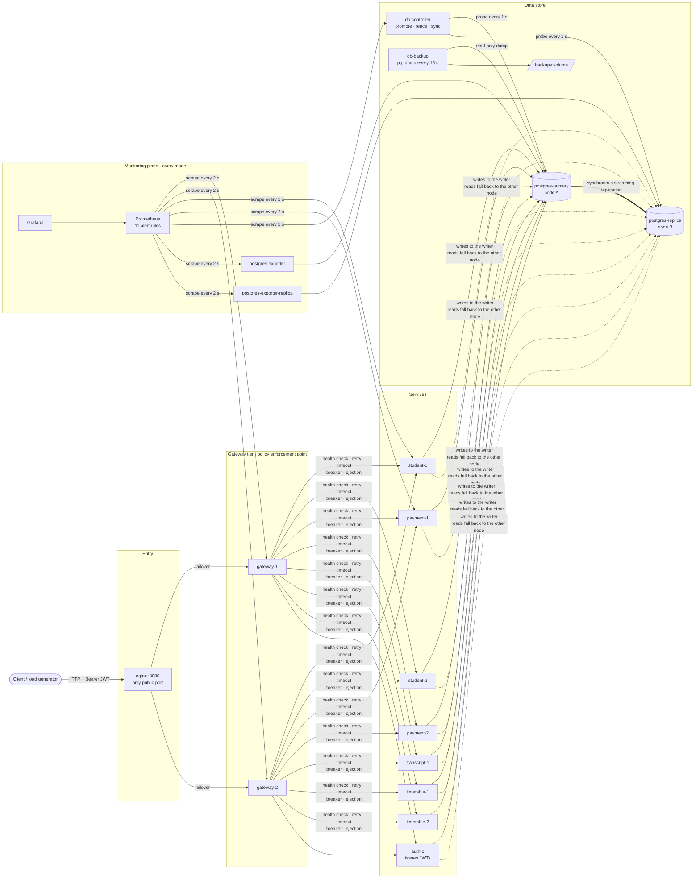
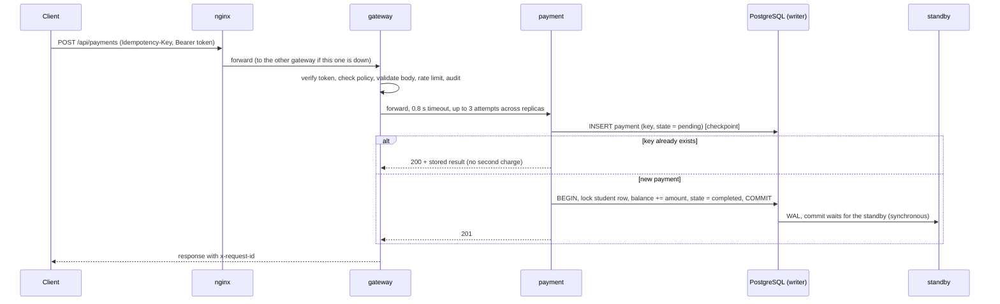
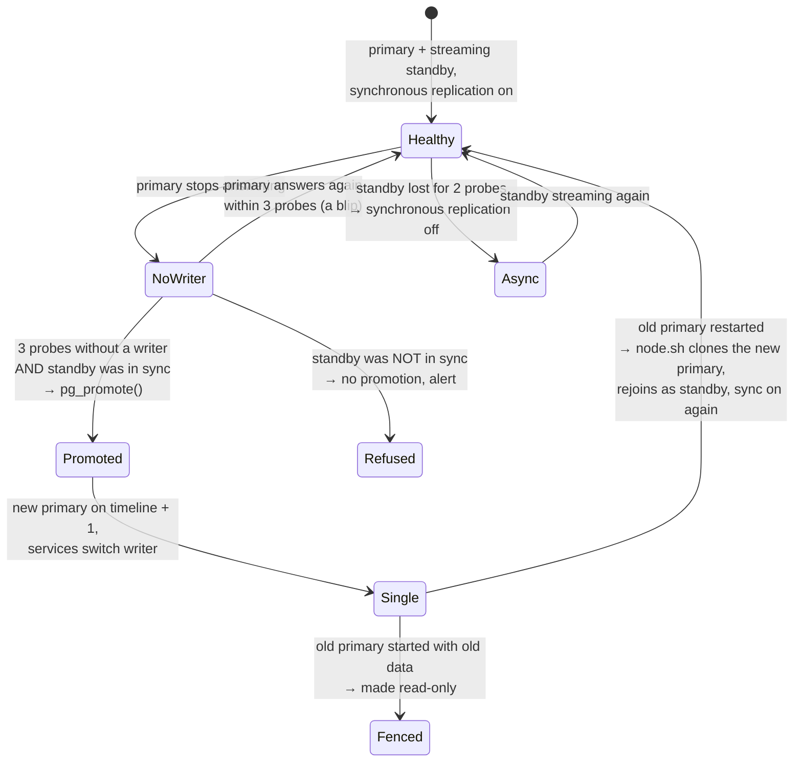
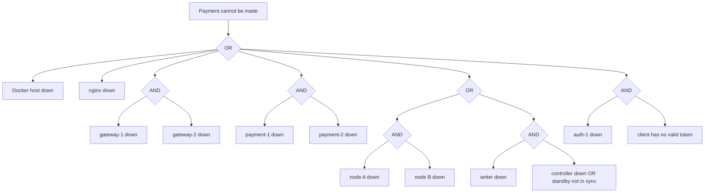

# Architecture

The deployment is `docker-compose.yml`; every box below is one container. The diagrams show the
**final** configuration. The baseline runs the same containers and does not use the redundancy
(TEST-PLAN.md §2).

## 1. Deployment and data flows

`postgres-primary` and `postgres-replica` are the names of the two database nodes, not their roles:
both run the same start script, and after a failover `postgres-replica` is the primary and
`postgres-primary` the standby.

## 2. Service boundaries and dependencies

| Component | Instances | Responsibility | Depends on | State |
|---|---|---|---|---|
| nginx | 1 | public entry point, failover between gateways | gateways | none |
| gateway | 2 | authentication, authorization, validation, rate limiting, audit; load balancing, health checks, retry, timeout, circuit breaker, outlier ejection, stale-cache degradation | services, `JWT_SECRET` | in memory (breaker, ejection, cache, rate-limit buckets) |
| auth | 1 | verifies passwords (scrypt), issues 15-minute JWTs | database | none |
| student | 2 | student records | database | none |
| payment | 2 | the critical workflow: idempotency check → checkpoint → atomic charge → completion | database | none (the checkpoint is in the database) |
| transcript | 1 | grade transcripts | database | none |
| timetable | 2 | long-running timetable jobs with checkpoints | database | none (checkpoints in the database) |
| PostgreSQL | 2 nodes | the persistent data store: students, payments, grades, timetable jobs, users | volume per node | durable |
| db-controller | 1 | observes both nodes; in final promotes, fences, switches synchronous replication | both nodes | in memory |
| db-backup | 1 | verified `pg_dump` every 15 s, 20 kept | one node | `backups/` |
| Prometheus, Grafana, exporters | 1 each | metrics, alert rules, dashboard | scrape targets | in memory |

## 3. The critical workflow: a payment

Where each step can fail and what answers it:

| Failure | Mechanism | Result |
|---|---|---|
| gateway dies | nginx failover; the client's key makes the re-send safe | request served by the other gateway |
| payment replica dies or is slow | health check, timeout, retry on the other replica, outlier ejection | request served by the other replica |
| crash between checkpoint and charge | the sweep rolls back a pending row older than 15 s; a client retry with the same key gets the stored result | no half-applied payment, no double charge |
| database primary dies | controller promotes the standby; services find the new writer; synchronous replication means the standby already has every acknowledged payment | payments resume in a few seconds, none lost |
| records destroyed | backup + merge restore | payments up to the last backup are recovered |

## 4. Redundancy, replication and backup

| Layer | Redundancy | Failure handling | What remains single |
|---|---|---|---|
| Entry | 1 nginx | restart policy | **nginx** (one public port on one host) |
| Gateway | 2, active-active | nginx `proxy_next_upstream` | – |
| student, payment, timetable | 2 each, active-active | gateway health check, retry, ejection | – |
| transcript | 1 | stale cache serves reads | **transcript-1** (degrades, does not fail) |
| auth | 1 | tokens are verified locally by the gateways | **auth-1** (no new logins while it is down) |
| Database | primary + hot standby, synchronous | automatic promotion, fencing, automatic rejoin | – (for one node failure) |
| Data | 20 verified dumps, 15 s apart | merge restore | the backups are on the same host |
| Controller | 1 | restart policy; without it the database behaves as in endterm (no automatic promotion) | **db-controller** (fail-safe: its failure causes no outage) |
| Host | 1 | – | **the Docker host** (common mode) |

## 5. Database failover in detail

- **Detection:** the controller probes both nodes once a second; three consecutive probes without
  a writable node trigger the promotion (`FAILOVER_THRESHOLD`).
- **Writer discovery:** every service asks both nodes for their role twice a second, and at once
  after a failed write. Writes go to the node that is not in recovery, not fenced, and on the
  highest timeline (`pick_writer`, `app/fault_tolerance/infrastructure/db_failover.py`).
- **No acknowledged write is lost:** while a standby streams, commits wait for it. A standby that
  was not in sync when the primary was last seen is never promoted.
- **No split brain between services:** a promotion always starts a new timeline, so a stale
  primary that comes back loses the comparison everywhere, and the controller makes it read-only.
- **Rejoin:** when the old primary's container starts and finds its peer is a primary on a higher
  timeline, it discards its data and clones the peer (`config/postgres/scripts/node.sh`).

## 6. Fault tree for "a payment cannot be made"

First-order cut sets (single points of failure) in final: the host and nginx. In the baseline every
leaf of the tree is a first-order cut set for the requests that reach it, because nothing fails over.

## 7. Trust boundaries

Unchanged from the endterm (`THREAT-MODEL.md` §1): B1 client → nginx, B2 nginx → gateways,
B3 gateway → services, B4 services → PostgreSQL, B5 host and operator. The final adds two
principals inside B4, each with its own least-privilege database role: the controller (`failover`)
and the backup sidecar (`backup`).
